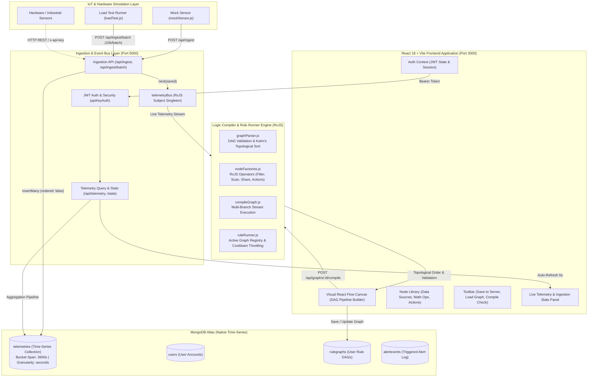

# NexusFlow - Visual IoT Telemetry & Rule Engine

NexusFlow is an enterprise-grade IoT telemetry ingestion pipeline and reactive rule engine built on the **MERN** stack (MongoDB, Express, React, Node.js). It enables engineers to ingest high-frequency IoT sensor telemetry into native MongoDB Time-Series collections, visually model event-driven processing pipelines using an interactive node canvas powered by React Flow, and compile visual Directed Acyclic Graphs (DAGs) into executable **RxJS reactive event streams**.

For a comprehensive beginner-friendly onboarding guide with factory manager analogies and architecture deep-dives, see [**`docs/PROJECT_EXPLAINED.md`**](file:///c:/NexusFlow/docs/PROJECT_EXPLAINED.md).

---

## ⚡ Architecture & Tech Stack



- **Backend**:
  - **Runtime**: Node.js (ES Modules)
  - **Framework**: Express.js
  - **Database**: MongoDB with verified native **Time-Series Collections** (`timeseries: { timeField: "timestamp", metaField: "metadata", granularity: "seconds" }`)
  - **ODM & Indexing**: Mongoose with compound indexing on `metadata.deviceId` and `timestamp`
  - **Reactive Stream Engine**: RxJS (`rxjs`) for DAG compilation, branching via `share()`, and pipeline operators (`filter`, `scan`, `map`, `tap`)
  - **Rule Runner**: In-memory active graph manager (`ruleRunner.js`) subscribing to `telemetryBus` with dynamic activation/deactivation and cooldown suppression
  - **Alert Logging**: Persistent alert event history (`AlertEvent.js`) with indexed queries and per-rule cooldown throttling
  - **Authentication**: JWT (`jsonwebtoken`) & password hashing with `bcryptjs`
  - **Validation**: Server-side DAG validation (Kahn's topological sort, cycle detection, orphan detection)
  - **Security**: Optional `x-api-key` ingestion gate via `INGEST_API_KEY`
  - **Real-Time Communication**: WebSockets (`ws`)
- **Frontend**:
  - **Framework**: React 18 + Vite
  - **Routing**: `react-router-dom` v7
  - **State & Auth**: React Context API (`AuthContext`) with persistent JWT sessions in `localStorage`
  - **Canvas & Flow Builder**: `@xyflow/react` (React Flow) with custom nodes, interactive controls, and DAG connection validation
  - **Node Library**: Categorized palette (Data Sources, Math Operations, Action Triggers) with inline configuration editing
  - **Graph Persistence & Execution**: Graph Name toolbar, Save/Update to Server, Load Graph dropdown, Compile Check modal, Activate/Deactivate controls, and Status Badge (`draft` / `active`)
  - **Alerts & Graphs Drawers**: Live Alert Log drawer polling `/api/alerts` every 5 seconds and "My Graphs" manager drawer (open, rename, delete)
  - **Testing**: Vitest for graph serialization & topological validation (`serializeGraph.test.js`)
  - **HTTP Client**: Axios with automatic Bearer token interceptor
  - **Icons & Styling**: Lucide React + Cyberpunk/Industrial IoT Dark Navy Aesthetic

---

## 📁 Repository Structure

```
NexusFlow/
├── .gitignore                      # Git ignore rules for Node, Vite, logs & env
├── README.md                       # Comprehensive documentation & roadmap
├── docs/                           # Project documentation & audit reports
│   ├── PROJECT_EXPLAINED.md        # Beginner guide, architecture, data flow & 15 review Q&As
│   ├── graph.schema.json           # JSON Schema (Draft-07) for React Flow DAG serialization
│   ├── graph-serialization-proof.md# Topology & serialization verification report
│   ├── ingestion-audit.md          # WAN Atlas vs active rule evaluation benchmark audit
│   ├── week1-ingestion-report.md   # Benchmarks (10k+ writes/sec, 7 bytes/doc audit)
│   └── week1-summary.md            # Week 1 summary, screenshot checklist & transition
├── backend/                        # Node.js + Express backend service
│   ├── .env.example                # Example environment configuration (PORT, MONGO_URI, JWT, INGEST_API_KEY)
│   ├── package.json                # Backend dependencies and scripts
│   ├── server.js                   # Server bootstrap with HTTP, WebSocket & graceful shutdown
│   ├── tests/
│   │   ├── compiler.test.js        # Unit test suite for RxJS logic compiler (6/6 passing)
│   │   └── ruleRunner.test.js      # Unit test suite for active rule execution & cooldowns (6/6 passing)
│   ├── scripts/
│   │   ├── auditIngestionWithRule.js# Comparative ingestion benchmark with active rule evaluation
│   │   ├── loadTest.js             # High-throughput batched ingestion load test runner
│   │   ├── mockSensor.js           # Simulated IoT turbine sensor generator
│   │   ├── storageStats.js         # Time-series storage footprint inspector ($collStats)
│   │   ├── testAuth.js             # Automated auth test suite
│   │   ├── testIngest.js           # Automated ingestion and query test suite
│   │   ├── testWeek2Compiler.js    # Automated graph persistence & compiler integration suite (14/14 passing)
│   │   └── validateGraphProof.js   # Script verifying schema & topological compile of complex proof DAG
│   └── src/
│       ├── app.js                  # Express application setup and routing
│       ├── compiler/               # RxJS Logic Compiler & Rule Runner Engine
│       │   ├── telemetryBus.js      # Singleton RxJS Subject event highway
│       │   ├── graphParser.js       # DAG validator, cycle detector & Kahn's topological sort
│       │   ├── nodeFactories.js     # RxJS operators (Filter, Scan, Share, Actions with Cooldown)
│       │   ├── compileGraph.js      # Pipeline wiring with multi-branching (.pipe(share()))
│       │   └── ruleRunner.js        # Active graph manager (activate, deactivate, stopAll, cooldown)
│       ├── config/
│       │   └── db.js               # MongoDB connection lifecycle & time-series startup verification
│       ├── controllers/
│       │   ├── alert.controller.js # Alert event query handler (/api/alerts)
│       │   ├── auth.controller.js  # Register, Login, and Me profile handlers
│       │   ├── ingest.controller.js# Ingest, query & stats aggregation handlers (non-blocking bus push)
│       │   └── graph.controller.js # Protected graph CRUD, compile, activate & deactivate handlers
│       ├── middleware/
│       │   ├── apiKeyAuth.js       # Optional x-api-key header ingestion verification
│       │   ├── auth.js             # JWT verification & req.user attachment
│       │   └── errorHandler.js     # Centralized error handler & 404 handler
│       ├── models/
│       │   ├── AlertEvent.js       # Triggered rule alert event schema with indexes
│       │   ├── Telemetry.js        # MongoDB Time-Series Mongoose schema with compound indexes
│       │   ├── User.js             # User account schema with password hashing
│       │   └── RuleGraph.js        # Rule graph schema for React Flow DAG persistence
│       └── routes/
│           ├── alert.routes.js     # Protected alert query routes (/api/alerts)
│           ├── auth.routes.js      # Auth endpoints (/register, /login, /me)
│           ├── ingest.routes.js    # Ingestion & protected telemetry endpoints
│           └── graph.routes.js     # Protected rule graph CRUD, compile, activate & deactivate endpoints
└── frontend/                       # React + Vite frontend client
    ├── .env.example                # Example frontend environment variables
    ├── index.html                  # HTML entry point
    ├── package.json                # Frontend dependencies and scripts (vitest)
    ├── vite.config.js              # Vite bundler configuration & backend proxy
    └── src/
        ├── main.jsx                # React DOM mount point
        ├── App.jsx                 # App router with protected & public routes
        ├── index.css               # Styling for landing, auth, canvas toolbar, nodes, drawers & dashboard
        ├── api/
        │   ├── client.js           # Axios client with Bearer token interceptor
        │   └── graphs.js           # Graph CRUD, activation, deactivation & alert fetching service
        ├── context/
        │   └── AuthContext.jsx     # Global authentication provider & hook
        ├── utils/
        │   ├── serializeGraph.js   # Graph JSON serializer and topology validator (DAG / orphans)
        │   └── serializeGraph.test.js # Vitest test suite for 15-node DAG serialization & validation
        ├── components/
        │   ├── Navbar.jsx          # Public navigation bar with auth CTA
        │   ├── Footer.jsx          # Platform footer with links & status
        │   ├── ProtectedRoute.jsx  # Route guard redirecting to /login
        │   ├── Canvas.jsx          # Interactive React Flow workspace with status badge & activate controls
        │   ├── Sidebar.jsx         # Draggable categorized node palette (Data Sources, Math, Actions)
        │   └── nodes/
        │       ├── nodeRegistry.js       # Central node type map, categories & default configs
        │       ├── DataSourceNode.jsx    # Custom node (Turbine, Temperature, Custom Device)
        │       ├── MathOperationNode.jsx # Custom node (Threshold, Moving Average, Sum, Min, Max)
        │       └── ActionTriggerNode.jsx # Custom node (SMS Alert, REST Webhook)
        └── pages/
            ├── Landing.jsx         # Marketing landing page (Hero, Features, Steps)
            ├── Register.jsx        # Engineer signup page with form validation
            ├── Login.jsx           # Engineer signin page with JWT authentication
            └── Dashboard.jsx       # Protected IoT rule canvas, live alerts drawer & graph manager drawer
```

---

## 🔐 Environment Variables

### Backend (`/backend/.env`)
```env
PORT=5000
MONGO_URI=mongodb://localhost:27017/nexusflow # or MongoDB Atlas Replica Set URI
JWT_SECRET=your_jwt_secret_key_production_random_string_2026
JWT_EXPIRES_IN=7d

# Optional: Data retention TTL in days for native Time-Series collection (default unset / 0 = disabled)
TELEMETRY_RETENTION_DAYS=

# Optional: Rate limiting controls (defaults: auth 30/15m, api 1000/15m, ingest unlimited)
AUTH_RATE_LIMIT=30
API_RATE_LIMIT=1000
INGEST_RATE_LIMIT=

# Optional: Set INGEST_API_KEY to enforce x-api-key header on /api/ingest routes. Leave blank for open IoT ingest.
INGEST_API_KEY=
```

### Frontend (`/frontend/.env`)
```env
VITE_API_URL=http://localhost:5000
```

---

## 🚀 Setup & Execution Guide (2 Terminals)

### Terminal 1 — Start Backend Server
```powershell
cd backend
npm run dev
```
*(Runs on `http://localhost:5000`)*

### Terminal 2 — Start Frontend Application
```powershell
cd frontend
npm run dev
```
*(Runs on `http://localhost:3000`)*

---

## 🛠️ NPM Scripts Reference

### Backend Scripts (`/backend`)
| Script | Command | Purpose |
| :--- | :--- | :--- |
| `npm run dev` | `nodemon server.js` | Starts backend development server with auto-reload |
| `npm start` | `node server.js` | Starts backend production server |
| `npm test` | `testAuth && testIngest && testGraph && compiler.test && test:runner && test:hardening` | Runs full automated test suite |
| `npm run test:compiler`| `node --test tests/compiler.test.js` | Unit tests for RxJS logic compiler (valid, cycles, orphans, thresholds, MA, branches) |
| `npm run test:runner` | `node --test tests/ruleRunner.test.js` | Unit tests for active rule execution, alert creation, cooldown suppression & error isolation |
| `npm run test:hardening`| `node --test tests/hardening.test.js` | Unit tests for rate limiting, malformed JSON format { error, details }, request ID & graceful stopAll |
| `npm run test:graph` | `node scripts/testWeek2Compiler.js` | Full integration test for graph CRUD, cycle rejection, compilation, activation, alert logging & deactivation (14/14 passing) |
| `npm run test:auth` | `node scripts/testAuth.js` | Validates registration, login, JWT token, and profile routes |
| `npm run test:ingest` | `node scripts/testIngest.js` | Validates single/batch ingestion, caps, error handling & stats |
| `npm run mock` | `node scripts/mockSensor.js` | Generates simulated turbine temperature telemetry every 1,000ms |
| `npm run loadtest` | `node scripts/loadTest.js` | Stress tests ingestion velocity (supports `--duration`, `--batch-size`, `--warmup`) |
| `npm run storage:stats`| `node scripts/storageStats.js`| Inspects MongoDB Time-Series storage size and bytes/record |
| Demo Seeder | `node scripts/seedDemo.js` | Idempotently provisions `demo@nexusflow.io` and 3 pre-built industrial templates |
| Verification | `node scripts/validateGraphProof.js` | Validates complex 15-node DAG against Draft-07 JSON Schema and topological compiler |
| Benchmark Audit | `node scripts/auditIngestionWithRule.js` | Compares ingestion throughput with and without active RxJS rule evaluation |

### Frontend Scripts (`/frontend`)
| Script | Command | Purpose |
| :--- | :--- | :--- |
| `npm run dev` | `vite` | Starts Vite React development server on port 3000 |
| `npm run build` | `vite build` | Compiles production assets into `dist/` |
| `npm run preview` | `vite preview` | Previews production build locally |
| `npm test` | `vitest run` | Runs Vitest test suite for graph serialization, Draft-07 schema compliance & cycle detection |

---

## 📡 REST API & WebSocket Reference

### Authentication Endpoints
| Method | Endpoint | Access | Description |
| :--- | :--- | :--- | :--- |
| `POST` | `/api/auth/register` | Public | Register new user account (hashes password, rejects duplicate email with 409) |
| `POST` | `/api/auth/login` | Public | Authenticate user credentials & issue JWT token |
| `GET` | `/api/auth/me` | **Bearer Token** | Retrieve currently authenticated user profile |

### Telemetry & Ingestion Endpoints
| Method | Endpoint | Access | Description |
| :--- | :--- | :--- | :--- |
| `GET` | `/api/health` | Public | Service health status & DB connectivity |
| `POST` | `/api/ingest` | Public (IoT) | Ingest single telemetry reading, save to Time-Series & non-blocking push to `telemetryBus` |
| `POST` | `/api/ingest/batch` | Public (IoT) | High-throughput batch ingestion (`ordered: false`, max 10,000) & non-blocking push to `telemetryBus` |
| `GET` | `/api/telemetry` | **Bearer Token** | Query recent readings (deviceId, sensorType, from, to, limit 1-1000) |
| `GET` | `/api/telemetry/stats` | **Bearer Token** | Aggregation pipeline returning count, min, max, avg over N minutes |
| `WS` | `ws://localhost:5000` | Public | Real-time WebSocket event stream |

### Rule Graph Persistence & Activation Endpoints
| Method | Endpoint | Access | Description |
| :--- | :--- | :--- | :--- |
| `POST` | `/api/graphs` | **Bearer Token** | Save new rule graph (validates DAG, rejects cycles/orphans) |
| `GET` | `/api/graphs` | **Bearer Token** | List all rule graphs owned by the authenticated user |
| `GET` | `/api/graphs/active` | **Bearer Token** | List all currently executing rule graphs for the authenticated user |
| `GET` | `/api/graphs/:id` | **Bearer Token** | Retrieve a specific rule graph by ID |
| `PUT` | `/api/graphs/:id` | **Bearer Token** | Update rule graph name, description, or JSON topology |
| `DELETE` | `/api/graphs/:id` | **Bearer Token** | Delete a saved rule graph (automatically stops active subscription if running) |
| `POST` | `/api/graphs/:id/compile`| **Bearer Token** | Dry-run compile saved graph into executable RxJS streams |
| `POST` | `/api/graphs/compile` | **Bearer Token** | Dry-run compile current unsaved canvas graph payload |
| `POST` | `/api/graphs/:id/activate` | **Bearer Token** | Compile and execute graph against `telemetryBus`, set status `"active"` |
| `POST` | `/api/graphs/:id/deactivate` | **Bearer Token** | Unsubscribe and stop active rule graph, set status `"draft"` |

### Alert Event Endpoints
| Method | Endpoint | Access | Description |
| :--- | :--- | :--- | :--- |
| `GET` | `/api/alerts` | **Bearer Token** | Retrieve triggered alert event history (supports `?graphId=<id>&limit=<n>`, default limit 50, max 200) |

> [!NOTE]
> **Server Startup Behavior**: On server startup, graphs are preserved in MongoDB with their status (`draft` or `active`), but they are **not auto-activated** into memory automatically. They can be dynamically activated on-demand via the canvas UI or the `POST /api/graphs/:id/activate` endpoint.
>
> **Alert Cooldown Throttling**: Action Trigger nodes support configurable `cooldownSeconds` (default: 10s). When a sensor reading continuously breaches a threshold, an alert is persisted immediately upon the initial breach, but subsequent alerts are throttled until the cooldown window expires to prevent alert fatigue.

---

## 🎬 Demo Account & Mid-Project Review Walkthrough

For evaluating NexusFlow or presenting the live system, use the pre-built idempotent seeder:

```powershell
# 1. Seed demo user & 3 industrial rule templates into MongoDB Atlas
cd backend
node scripts/seedDemo.js

# 2. Start services (2 terminals)
# Terminal 1: cd backend; npm run dev
# Terminal 2: cd frontend; npm run dev
```

### Review Demo Credentials:
| Field | Value |
| :--- | :--- |
| **Login URL** | `http://localhost:3000/login` |
| **Email** | `demo@nexusflow.io` |
| **Password** | `DemoUser2026!` |
| **Security Scope** | *Demo Account — Non-Production* |

- 📄 **8-Minute Demo Script**: See [**`scripts/demo.md`**](file:///c:/NexusFlow/scripts/demo.md) for step-by-step presentation actions.
- 📋 **Evaluation Checklist**: See [**`docs/mid-project-review-checklist.md`**](file:///c:/NexusFlow/docs/mid-project-review-checklist.md) for criteria mapping and defense Q&A.

---

## 🗺️ 4-Week Implementation Roadmap

### **Week 1: Core Foundation & Telemetry Ingestion**
- [x] **Time-Series Ingestion Architecture (Complete & Audited)**
  - Native MongoDB Time-Series collection verified on startup (`timeField: "timestamp"`, `metaField: "metadata"`, `granularity: "seconds"`).
  - High-performance compound indexes on `{ 'metadata.deviceId': 1, timestamp: -1 }`.
  - Express ingestion REST APIs (`/api/health`, `/api/ingest`, `/api/ingest/batch`, `/api/telemetry`, `/api/telemetry/stats`).
  - Cap batch ingestion at 10,000 documents with un-ordered bulk writes.
  - JWT authentication flow (`/register`, `/login`, `/me`) and protected query endpoints.
  - Load test runner achieving **10,172 writes/sec** (`scripts/loadTest.js`).
  - Storage footprint inspector demonstrating **7.05 bytes/doc** (`scripts/storageStats.js`).
  - Interactive React Flow canvas with custom nodes, toolbar, and portable graph JSON serialization.

### **Week 2: Logic Compiler, Rule Runner & Mid-Project Review**
- [x] **Logic Compiler Foundation (RxJS)**:
  - Installed `rxjs` and built `backend/src/compiler/`.
  - `telemetryBus.js`: Singleton RxJS `Subject` receiving every ingested reading.
  - `graphParser.js`: Server-side DAG validation, cycle detection, orphan detection, and Kahn's topological sort.
  - `nodeFactories.js`: Stream operators for Data Sources, Math Operations (Threshold, Moving Average, Sum, Min, Max), and Action Trigger sinks.
  - `compileGraph.js`: Pipeline assembler supporting branching via `.pipe(share())` with lifecycle controller (`start`, `stop`, `metadata`).
  - Unit test suite (`tests/compiler.test.js`) verifying valid compilation, cycle rejection, orphan rejection, threshold triggers, moving averages, and independent branching (6/6 passing).
- [x] **Graph Persistence & Dry-Run Compiler API**:
  - `RuleGraph` Mongoose model scoped to authenticated user with status (`draft` \| `active`).
  - Scoped CRUD routes (`POST /api/graphs`, `GET /api/graphs`, `GET /api/graphs/:id`, `PUT /api/graphs/:id`, `DELETE /api/graphs/:id`).
  - Dry-run compilation endpoints (`POST /api/graphs/:id/compile` and `POST /api/graphs/compile`).
  - Integration test suite (`scripts/testWeek2Compiler.js`) passing all 14 tests.
- [x] **Rule Runner Engine & Dynamic Activation**:
  - `ruleRunner.js`: In-memory active graph manager (`activate`, `deactivate`, `listActive`, `stopAll`).
  - Subscribes dynamically to `telemetryBus` with non-blocking error isolation during ingestion.
  - Endpoints: `POST /api/graphs/:id/activate`, `POST /api/graphs/:id/deactivate`, `GET /api/graphs/active`.
  - Auto-deactivation on graph deletion and graceful shutdown hook on `SIGTERM` / `SIGINT`.
  - Unit test suite (`tests/ruleRunner.test.js`) passing all 6 tests.
- [x] **Alert Event Persistence & Cooldown Suppression**:
  - `AlertEvent` Mongoose model (`graphId`, `owner`, `ruleName`, `actionType`, `target`, `reading`, `message`, `triggeredAt`) with compound index on `{ owner: 1, triggeredAt: -1 }`.
  - Configurable `cooldownSeconds` (default: 10s) to suppress duplicate alert floods during sustained breaches.
  - Protected API: `GET /api/alerts?graphId=&limit=`.
- [x] **Node Library & Interactive Canvas Controls**:
  - Categorized palette (Data Sources, Math Operations, Action Triggers) with inline configuration editing.
  - Canvas toolbar: Status badge (`draft` / `active`), dynamic **Activate / Deactivate** button, Save to Server, Load Graph, and Compile Check modal.
  - Dashboard Drawers: **Live Alerts Drawer** (polling `/api/alerts` every 5s with loading, empty, and alert state chips) and **My Graphs Drawer** (open, rename, delete with confirmation).
- [x] **Mid-Project Review Evidence & Performance Audit**:
  - **Graph Serialization Proof**: Draft-07 JSON Schema (`docs/graph.schema.json`), 7-test Vitest suite (`frontend/src/utils/serializeGraph.test.js`) verifying 15-node DAG serialization, and verification report (`docs/graph-serialization-proof.md`).
  - **Ingestion Audit**: Storage stats (323k+ docs, 6.56 bytes/doc, ~94.5% compression) and comparative benchmark with active rule (`backend/scripts/auditIngestionWithRule.js`, `docs/ingestion-audit.md`).
- [x] **Ingestion Performance & Storage Efficiency**:
  - Compound index streamlining: removed redundant single-field indexes, cutting index write amplification in half.
  - Lean batch insert path with `ordered: false` and `lean: true`.
  - Added warmup phase and `p50`/`p95` latency calculation to `loadTest.js`.
  - Storage stats: **323,240 documents** stored in **6.56 bytes/doc** (**94.5% storage space reduction**).
  - Optional data retention setting: `TELEMETRY_RETENTION_DAYS` (TTL).
- [x] **Backend Hardening & Security**:
  - Helmet security headers, rate limiting (`authLimiter`, `apiLimiter`, `ingestLimiter`), 10MB payload size limits.
  - Request ID tracing middleware (`X-Request-Id` and duration logging).
  - Consistent JSON error response format `{ error, details }`.
  - Graceful shutdown handling `SIGTERM`/`SIGINT` closing active rules, WebSockets, HTTP, and MongoDB cleanly.
  - Test suite (`tests/hardening.test.js`) passing 5/5 tests.
- [x] **Canvas Usability & Live Problem Detection**:
  - Undo/Redo (`Ctrl+Z`, `Ctrl+Y`) with 25-step history stack.
  - Node duplication (`Ctrl+D`), multi-select delete (`Delete`/`Backspace`).
  - Topological auto-layout arranging nodes left-to-right by dependency depth.
  - 3 pre-built industrial templates (Turbine Overheat, Two-Sensor Branching, 15-node Complex DAG).
  - Live collapsible Problems drawer and red outline/badge highlights on incomplete nodes.
  - Keyboard shortcuts cheat sheet popover (`?`).
- [x] **Demo & Review Readiness**:
  - Idempotent database seeder (`seedDemo.js`) creating `demo@nexusflow.io` and 3 pre-built templates.
  - 8-minute presentation walkthrough script (`scripts/demo.md`).
  - Mid-Project Review checklist & defense Q&A (`docs/mid-project-review-checklist.md`).

### **Week 3: Live Telemetry Streaming & Real-Time Canvas Feedback**
- [ ] **WebSocket Telemetry Stream**: Connect incoming sensor telemetry to active WebSocket rooms.
- [ ] **Live Visual Feedback**: Dynamic pulse animations on React Flow connection edges when telemetry flows through.
- [ ] **Canvas Real-Time Badges**: Live stream value pills on nodes displaying latest evaluated readings in browser.

### **Week 4: Webhooks, Actuator Alerting & Production Hardening**
- [ ] **Outbound Action Webhooks**: Automated dispatching to external APIs and real SMS services when rules trigger.
- [ ] **Actuator Controls**: Bi-directional command dispatch to physical IoT edge devices.
- [ ] **Final Deployment**: Docker containerization, staging deployment, and end-to-end integration polish.
