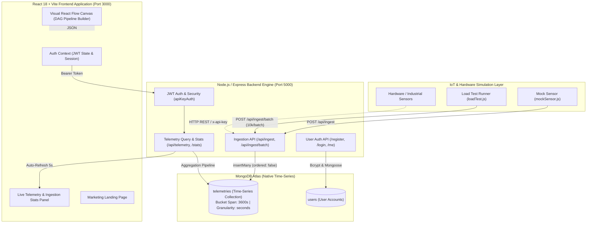

# NexusFlow - Visual IoT Telemetry & Rule Engine

NexusFlow is an enterprise-grade IoT telemetry ingestion pipeline and reactive rule engine built on the **MERN** stack (MongoDB, Express, React, Node.js). It enables engineers to ingest high-frequency IoT sensor telemetry into native MongoDB Time-Series collections and visually model event-driven processing pipelines using an interactive node canvas powered by React Flow.

---

## ⚡ Architecture & Tech Stack



- **Backend**:
  - **Runtime**: Node.js (ES Modules)
  - **Framework**: Express.js
  - **Database**: MongoDB with verified native **Time-Series Collections** (`timeseries: { timeField: "timestamp", metaField: "metadata", granularity: "seconds" }`)
  - **ODM & Indexing**: Mongoose with compound indexing on `metadata.deviceId` and `timestamp`
  - **Authentication**: JWT (`jsonwebtoken`) & password hashing with `bcryptjs`
  - **Validation**: `express-validator` for structured schema and request validation
  - **Security**: Optional `x-api-key` ingestion gate via `INGEST_API_KEY`
  - **Real-Time Communication**: WebSockets (`ws`)
  - **Utilities**: CORS, Dotenv, Centralized Error Handling
- **Frontend**:
  - **Framework**: React 18 + Vite
  - **Routing**: `react-router-dom` v7
  - **State & Auth**: React Context API (`AuthContext`) with persistent JWT sessions in `localStorage`
  - **Canvas & Flow Builder**: `@xyflow/react` (React Flow) with custom nodes, interactive controls, and DAG connection validation
  - **Serialization**: Portable JSON graph compiler with acyclicity and orphan node validation
  - **HTTP Client**: Axios with automatic Bearer token interceptor
  - **Icons & Styling**: Lucide React + Custom Dark Navy IoT Aesthetic

---

## 📁 Repository Structure

```
NexusFlow/
├── .gitignore                      # Git ignore rules for Node, Vite, logs & env
├── README.md                       # Comprehensive documentation & roadmap
├── docs/                           # Project documentation & audit reports
│   ├── week1-ingestion-report.md   # Benchmarks (10k+ writes/sec, 7 bytes/doc audit)
│   └── week1-summary.md            # Week 1 summary, screenshot checklist & transition
├── backend/                        # Node.js + Express backend service
│   ├── .env.example                # Example environment configuration (PORT, MONGO_URI, JWT, INGEST_API_KEY)
│   ├── package.json                # Backend dependencies and scripts
│   ├── server.js                   # Server bootstrap with HTTP & WebSocket server
│   ├── scripts/
│   │   ├── loadTest.js             # High-throughput batched ingestion load test runner
│   │   ├── mockSensor.js           # Simulated IoT turbine sensor generator
│   │   ├── storageStats.js         # Time-series storage footprint inspector ($collStats)
│   │   ├── testAuth.js             # Automated auth test suite
│   │   └── testIngest.js           # Automated ingestion and query test suite
│   └── src/
│       ├── app.js                  # Express application setup and routing
│       ├── config/
│       │   └── db.js               # MongoDB connection lifecycle & time-series startup verification
│       ├── controllers/
│       │   ├── auth.controller.js  # Register, Login, and Me profile handlers
│       │   └── ingest.controller.js# Ingest, query & stats aggregation handlers
│       ├── middleware/
│       │   ├── apiKeyAuth.js       # Optional x-api-key header ingestion verification
│       │   ├── auth.js             # JWT verification & req.user attachment
│       │   └── errorHandler.js     # Centralized error handler & 404 handler
│       ├── models/
│       │   ├── Telemetry.js        # MongoDB Time-Series Mongoose schema with compound indexes
│       │   └── User.js             # User account schema with password hashing
│       └── routes/
│           ├── auth.routes.js      # Auth endpoints (/register, /login, /me)
│           └── ingest.routes.js    # Ingestion & protected telemetry endpoints
└── frontend/                       # React + Vite frontend client
    ├── .env.example                # Example frontend environment variables
    ├── index.html                  # HTML entry point
    ├── package.json                # Frontend dependencies and scripts
    ├── vite.config.js              # Vite bundler configuration & backend proxy
    └── src/
        ├── main.jsx                # React DOM mount point
        ├── App.jsx                 # App router with protected & public routes
        ├── index.css               # Styling for landing, auth, canvas toolbar, nodes & dashboard
        ├── api/
        │   └── client.js           # Axios client with Bearer token interceptor
        ├── context/
        │   └── AuthContext.jsx     # Global authentication provider & hook
        ├── utils/
        │   └── serializeGraph.js   # Graph JSON serializer and topology validator (DAG / orphans)
        ├── components/
        │   ├── Navbar.jsx          # Public navigation bar with auth CTA
        │   ├── Footer.jsx          # Platform footer with links & status
        │   ├── ProtectedRoute.jsx  # Route guard redirecting to /login
        │   ├── Canvas.jsx          # Interactive React Flow workspace with toolbar & serialization modal
        │   ├── Sidebar.jsx         # Draggable node palette (Source, Math, Action)
        │   └── nodes/
        │       ├── DataSourceNode.jsx    # Custom node (Target device & sensor metric selector)
        │       ├── MathOperationNode.jsx # Custom node (Threshold, Moving Average, Cumulative Sum)
        │       └── ActionTriggerNode.jsx # Custom node (SMS Alert, REST Webhook Dispatcher)
        └── pages/
            ├── Landing.jsx         # Marketing landing page (Hero, Features, Steps)
            ├── Register.jsx        # Engineer signup page with form validation
            ├── Login.jsx           # Engineer signin page with JWT authentication
            └── Dashboard.jsx       # Protected IoT rule canvas & live telemetry inspection panel
```

---

## 🔐 Environment Variables

### Backend (`/backend/.env`)
```env
PORT=5000
MONGO_URI=mongodb://localhost:27017/nexusflow # or MongoDB Atlas URI
JWT_SECRET=your_jwt_secret_key_production_random_string_2026
JWT_EXPIRES_IN=7d

# Optional: Set INGEST_API_KEY to enforce x-api-key header on /api/ingest routes. Leave blank for open IoT ingest.
INGEST_API_KEY=
```

### Frontend (`/frontend/.env`)
```env
VITE_API_URL=http://localhost:5000
```

---

## 🚀 Setup & Execution Guide (2 Terminals)

### Prerequisites
- **Node.js**: v18.x or higher (tested on Node v24)
- **MongoDB**: v5.0+ (native Time-Series collection support) or MongoDB Atlas cluster

### Terminal 1 — Start Backend Server
```powershell
cd backend
npm run dev
```
*(Runs on `http://localhost:5000`)*

### Terminal 2 — Start Frontend Application
```powershell
cd frontend
npm run dev
```
*(Runs on `http://localhost:3000`)*

---

## 🛠️ NPM Scripts Reference

### Backend Scripts (`/backend`)
| Script | Command | Purpose |
| :--- | :--- | :--- |
| `npm run dev` | `nodemon server.js` | Starts backend development server with auto-reload |
| `npm start` | `node server.js` | Starts backend production server |
| `npm test` | `node scripts/testAuth.js && node scripts/testIngest.js` | Runs all automated backend tests (Auth & Ingest) |
| `npm run test:auth` | `node scripts/testAuth.js` | Validates registration, login, JWT token, and profile routes |
| `npm run test:ingest` | `node scripts/testIngest.js` | Validates single/batch ingestion, caps, error handling & stats |
| `npm run mock` | `node scripts/mockSensor.js` | Generates simulated turbine temperature telemetry every 1,000ms |
| `npm run loadtest` | `node scripts/loadTest.js` | Stress tests ingestion velocity (supports `--duration`, `--batch-size`) |
| `npm run storage:stats`| `node scripts/storageStats.js`| Inspects MongoDB Time-Series storage size and bytes/record |

### Frontend Scripts (`/frontend`)
| Script | Command | Purpose |
| :--- | :--- | :--- |
| `npm run dev` | `vite` | Starts Vite React development server on port 3000 |
| `npm run build` | `vite build` | Compiles production assets into `dist/` |
| `npm run preview` | `vite preview` | Previews production build locally |

---

## 📊 Ingestion Performance & Storage Footprint

Full details documented in [**`docs/week1-ingestion-report.md`**](file:///c:/NexusFlow/docs/week1-ingestion-report.md).

### Load Test Benchmark
```text
================================================================
 Total Telemetry Sent:    105,000 documents (sustained) / 154,000 (peak)
 Total Batches Sent:      105 successful (0 failed)
 Achieved Throughput:     10,172 writes/sec (sustained) / 18,135 writes/sec (peak)
 Average Batch Latency:   581 ms
 STATUS: PASS (Exceeded target 5,000 writes/sec requirement)
================================================================
```

### Storage Efficiency Audit
```text
================================================================
 Total Telemetry Records:     259,024 documents
 Underlying Storage Buckets:  318 buckets
 Compressed Storage Size:     1.742 MB
 Avg On-Disk Bytes / Record:  7.05 bytes
 Storage Space Reduction:     ~94.1% savings via native bucket compression
================================================================
```

---

## 📡 REST API & WebSocket Reference

### Authentication Endpoints
| Method | Endpoint | Access | Description | Payload / Headers |
| :--- | :--- | :--- | :--- | :--- |
| `POST` | `/api/auth/register` | Public | Register new user account (hashes password, rejects duplicate email with 409) | `{"name": "...", "email": "...", "password": "..."}` |
| `POST` | `/api/auth/login` | Public | Authenticate user credentials & issue JWT token | `{"email": "...", "password": "..."}` |
| `GET` | `/api/auth/me` | **Bearer Token** | Retrieve currently authenticated user profile | Header: `Authorization: Bearer <token>` |

### Telemetry & Ingestion Endpoints
| Method | Endpoint | Access | Description | Sample Request / Query |
| :--- | :--- | :--- | :--- | :--- |
| `GET` | `/api/health` | Public | Service health status & DB connectivity | N/A |
| `POST` | `/api/ingest` | Public (IoT) | Ingest single telemetry reading (optional API key) | `{"deviceId": "turbine-01", "sensorType": "temperature", "value": 74.2, "unit": "°C"}` |
| `POST` | `/api/ingest/batch` | Public (IoT) | High-throughput batch ingestion (`ordered: false`, max 10,000) | `[{"deviceId": "turbine-01", "sensorType": "temperature", "value": 75.1}, ...]` |
| `GET` | `/api/telemetry` | **Bearer Token** | Query recent readings (deviceId, sensorType, from, to, limit 1-1000) | `?deviceId=turbine-01&sensorType=temperature&limit=100` |
| `GET` | `/api/telemetry/stats` | **Bearer Token** | Aggregation pipeline returning count, min, max, avg over N minutes | `?deviceId=turbine-01&minutes=60` |
| `WS` | `ws://localhost:5000` | Public | Real-time WebSocket event stream | N/A |

---

## 🗺️ 4-Week Implementation Roadmap

### **Week 1: Core Foundation & Telemetry Ingestion**
- [x] **Time-Series Ingestion Architecture (Complete & Audited)**
  - MERN stack architecture scaffolded (`/backend` and `/frontend`).
  - Native MongoDB Time-Series collection verified on startup (`timeField: "timestamp"`, `metaField: "metadata"`, `granularity: "seconds"`).
  - High-performance compound indexes on `{ 'metadata.deviceId': 1, timestamp: -1 }`.
  - Express ingestion REST APIs (`/api/health`, `/api/ingest`, `/api/ingest/batch`, `/api/telemetry`, `/api/telemetry/stats`).
  - Cap batch ingestion at 10,000 documents with un-ordered bulk writes.
  - JWT authentication flow (`/register`, `/login`, `/me`) and protected query endpoints.
  - Simulated turbine sensor generator (`scripts/mockSensor.js`).
  - Load test runner achieving **10,172 writes/sec** (`scripts/loadTest.js`).
  - Storage footprint inspector demonstrating **7.05 bytes/doc** (`scripts/storageStats.js`).
  - Interactive React Flow canvas with custom nodes (`DataSourceNode`, `MathOperationNode`, `ActionTriggerNode`), DAG connection validation, toolbar, and portable graph JSON serialization.
  - Live Recent Telemetry panel and aggregation stats on Dashboard auto-refreshing every 5 seconds.

### **Week 2: Logic Compiler & Node Library** *(starts 17 Nov)*
- [ ] **Logic Compiler (RxJS)**: Build the Node.js stream engine that parses saved React Flow JSON graphs and compiles them into executable RxJS Observable pipelines.
- [ ] **Node Library Expansion**: Expand custom UI nodes with additional mathematical processors and action triggers.
- [ ] **Mid-Project Review**: Present Time-Series audit demonstrating 5,000+ writes/sec and graph serialization integrity.

### **Week 3: Live Rule Execution & Real-Time Dashboards**
- [ ] **In-Memory Rule Execution**: Connect incoming WebSocket telemetry to dynamically compiled RxJS pipelines to evaluate thresholds in memory.
- [ ] **Live Visual Dashboards**: Real-time charts subscribing to WebSocket streams.

### **Week 4: Webhooks, Actuator Alerting & Production Hardening**
- [ ] **Outbound Action Webhooks**: Automated dispatching to external APIs and mock SMS services when rules trigger.
- [ ] **Visual Wire Feedback**: Canvas connection wires pulsating when data passes through.
- [ ] **Final Deployment**: Docker containerization and end-to-end integration polish.
