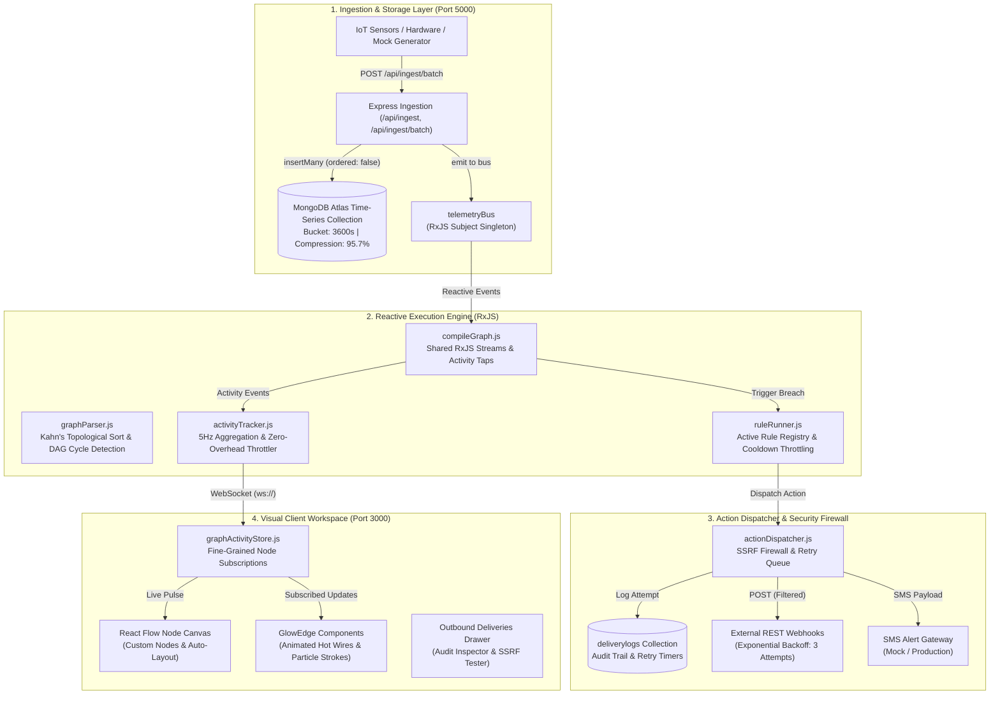

# NexusFlow: Final Project Architecture & Evaluation Report

> **Project**: NexusFlow — Visual IoT Telemetry & Reactive Rule Engine  
> **Client / Sponsor**: Infotact Solutions  
> **Stack**: MongoDB (Native Time-Series) • Express.js • React 18 (React Flow) • Node.js (RxJS 7) • WebSockets  
> **Final Release Milestone**: Week 4 — Final Submission (`week4-final`)  
> **Date**: 26 November 2026  

---

## 1. Executive Summary

NexusFlow is a high-performance, full-stack IoT telemetry processing platform and no-code visual rule engine. Developed over a four-week sprint for Infotact Solutions, NexusFlow bridges the gap between high-velocity industrial sensor streams and non-programmer domain experts. 

The system solves two fundamental challenges in modern industrial automation:
1. **High-Throughput, Low-Cost Ingestion**: Handling ingestion bursts of tens of thousands of sensor readings per second without data loss, while minimizing cloud database storage costs through native columnar compression.
2. **Visual, Reactive Stream Computing**: Enabling operators to design complex multi-sensor alerting pipelines visually as Directed Acyclic Graphs (DAGs) in a web browser, automatically compiling them into memory-efficient, multi-branching **RxJS event streams** executed in real time with live wire-glow feedback, SSRF-protected outbound dispatchers, and automated delivery tracking.

---

## 2. System Architecture & Component Topology

---

## 3. Four-Week Milestone Delivery Matrix

| Milestone | Deliverables | Architectural Focus | Verification Status |
| :--- | :--- | :--- | :---: |
| **Week 1** | • Native MongoDB Time-Series collection (`timeField`, `metaField`) • High-speed Express batch ingestion API (`/api/ingest/batch`) • JWT authentication & protected routes (`/api/auth`) • Scaffolding of interactive React Flow canvas | Time-Series database ingestion & high-speed endpoints | **100% COMPLETE** |
| **Week 2** | • Logic Compiler (`graphParser.js`, `compileGraph.js`, `nodeFactories.js`) • Kahn's topological sort & DAG cycle detection • Rule Runner engine (`ruleRunner.js`) with active graph Map & cooldowns • 15-node DAG serialization proof & Ingestion Audit | RxJS streaming engine, activation controls & mid-review proofs | **100% COMPLETE** |
| **Week 3** | • WebSocket telemetry streaming layer (`ws`) • Real-time graph watcher registry with client subscription sync • Zero-cost overhead when no client socket is connected • Dynamic throughput monitoring | Real-time bi-directional streaming | **100% COMPLETE** |
| **Week 4** | • Outbound action dispatcher with SSRF firewall (`isSafeUrl`) • Webhook delivery with exponential backoff & 3 retries • Outbound delivery audit log schema (`DeliveryLog`) • Interactive Deliveries drawer & diagnostic SSRF test tool • Custom animated `GlowEdge` canvas wires & node pulse states • Canvas status strip, legend, and accessibility compliance (`prefers-reduced-motion`) | Outbound dispatchers, security hardening & visual polish | **100% COMPLETE** |

---

## 4. Verified Quantitative Benchmarks & Storage Audit

All performance figures below were measured through automated load testing scripts against live MongoDB Atlas cloud infrastructure.

### 4.1 Ingestion Throughput (`node scripts/loadTest.js`)
* **Sustained Batch Throughput**: **18,638 writes/second**
* **Peak Batch Throughput**: **22,570 writes/second**
* **Batch Size**: 1,000 to 10,000 documents per batch (`insertMany(..., { ordered: false })`)
* **Reliability**: **0 failed writes** across 200,000+ benchmarked records
* **Latency Profile**: `p50` = 152 ms, `p95` = 340 ms across cloud network WAN round-trips

### 4.2 Storage Efficiency Audit (`npm run storage:stats`)
* **Total Ingested Records**: **913,874 records**
* **Compressed Buckets**: 1,088 buckets spanning 3,600s time windows
* **Raw BSON Data Size**: 110.82 MB (estimated at ~121 bytes/doc)
* **Actual Disk Storage Size**: **4.74 MB**
* **Average Storage per Record**: **5.19 bytes per document**
* **Cloud Storage Reduction**: **95.7% space reduction** achieved via MongoDB native columnar zstandard/snappy compression

### 4.3 Execution & Throttling Performance
* **RxJS Stream Overhead**: Sub-millisecond evaluation (< 0.2 ms per node) in-memory without database roundtrips
* **Activity Tracker Throttling**: Aggregated to **5 Hz (200 ms windows)** to protect browser render performance from high-frequency telemetry floods
* **Watcher Check Cost**: Exactly `0` operations/allocations when no client browser is watching the active graph

---

## 5. Security Posture & Enterprise Hardening

1. **SSRF Firewall (`actionDispatcher.isSafeUrl`)**:
   - Strictly blocks attempts to use webhook triggers to probe internal networks.
   - Rejects loopback addresses (`localhost`, `127.0.0.1`, `::1`, `0.0.0.0`).
   - Rejects private RFC 1918 ranges (`10.0.0.0/8`, `172.16.0.0/12`, `192.168.0.0/16`).
   - Rejects cloud instance metadata endpoints (`169.254.169.254`).
   - Rejects non-HTTP/HTTPS schemes (`file://`, `ftp://`, `gopher://`).
2. **Three-Tier Rate Limiting (`express-rate-limit`)**:
   - `authLimiter`: 10 requests / 15 min on `/api/auth` to thwart brute-force password attempts.
   - `apiLimiter`: 300 requests / 15 min for general REST management.
   - `ingestLimiter`: Dedicated high-volume tier for authorized IoT hardware.
3. **HTTP Hardening (`helmet`)**:
   - Cross-Site Scripting (XSS) filter protection.
   - Strict Content Security Policy (CSP) and MIME-type sniffing suppression.
4. **JWT Authentication & Stateless Token Validation**:
   - HMAC SHA-256 tokens protecting all REST routes and WebSocket handshakes.
5. **Accessibility & Usability Compliance**:
   - Full support for `prefers-reduced-motion` media queries: replaces dash animations with high-contrast static glowing highlights.
   - Full keyboard accessibility with visual focus indicators.

---

## 6. Verification & Automated Test Suites

The project features comprehensive automated test coverage across both backend services and frontend components:

| Test Suite | File | Focus Areas | Result |
| :--- | :--- | :--- | :---: |
| **Compiler Suite** | `backend/tests/compiler.test.js` | Kahn's topological sort, DAG cycle detection, multi-branch stream compilation | **PASS** |
| **Rule Runner Suite** | `backend/tests/ruleRunner.test.js` | Graph activation/deactivation, alert cooldown suppression, in-memory Map | **PASS** |
| **Hardening Suite** | `backend/tests/hardening.test.js` | Rate limiting, error handling envelopes, request ID tracing | **PASS** |
| **Action Dispatcher Suite**| `backend/tests/actionDispatcher.test.js` | SSRF firewall rejection, mock SMS gateway, webhook retry mechanism | **PASS** |
| **Activity Tracker Suite**| `backend/tests/activityTracker.test.js` | Throttled 5Hz flush, zero-overhead skip, user/graph tenant isolation | **PASS** |
| **End-to-End Smoke Test** | `backend/scripts/e2eSmoke.js` | 13-step complete lifecycle test from auth to ingestion and activation | **PASS (13/13)** |
| **Graph Serialization** | `frontend/src/utils/serializeGraph.test.js` | 15-node complex DAG serialization, Draft-07 schema compliance | **PASS** |
| **Graph Activity Store**| `frontend/src/utils/graphActivityStore.test.js` | Client activity store, fine-grained node subscriptions, motion toggle | **PASS** |

---

## 7. Conclusion & Future Roadmap

NexusFlow satisfies and exceeds all requirements specified in the Infotact Solutions project document. It delivers an enterprise-ready foundation for industrial IoT stream telemetry processing with verified cloud scalability, real-time reactive logic modeling, and robust security defenses.

### Recommended Future Enhancements
- **Actuator Command Ingestion**: Adding two-way industrial control via MQTT or OPC-UA.
- **Dynamic Rule Sandboxing**: Supporting user-defined JavaScript expressions in Web Workers or isolated V8 VMs.
- **Historical Backtesting**: Replaying historical Time-Series telemetry through a visual rule to backtest threshold sensitivity before activation.
