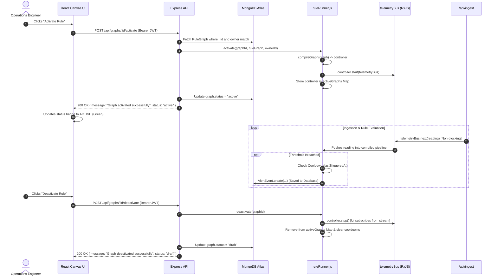

# NexusFlow: Complete Project Guide & Engineering Manual

> **Welcome to NexusFlow!**  
> If you are a college intern or new engineer joining the team, this guide will walk you through the *what*, *why*, and *how* behind NexusFlow. We avoid unnecessary jargon, explain real-world industry context with relatable analogies, trace data step-by-step from raw silicon hardware to modern browser canvases, and prepare you for any presentation or code review.

---

## Table of Contents
1. [What is NexusFlow? The Plain-English Explanation](#1-what-is-nexusflow-the-plain-english-explanation)
2. [High-Level Architecture Overview](#2-high-level-architecture-overview)
3. [Folder & File Guide](#3-folder--file-guide)
4. [The Journey of a Single Sensor Reading (Step-by-Step Data Flow)](#4-the-journey-of-a-single-sensor-reading)
5. [The Logic Compiler Explained (RxJS, DAGs, and Reactive Streams)](#5-the-logic-compiler-explained)
6. [Day 2 Changes: Rule Runner & Alert Engine](#6-day-2-changes-rule-runner--alert-engine)
7. [Day 3 Changes: Ingestion Tuning, API Hardening & Canvas UX](#7-day-3-changes-ingestion-tuning-api-hardening--canvas-ux)
8. [Mid-Project Review Evidence](#8-mid-project-review-evidence)
9. [Milestones Roadmap: Week 1 Through Week 4](#9-milestones-roadmap-week-1-through-week-4)
10. [Glossary of Core Engineering Terms](#10-glossary-of-core-engineering-terms)
11. [20 Critical Presentation Questions & Model Answers](#11-20-critical-presentation-questions--model-answers)

---

## 1. What is NexusFlow? The Plain-English Explanation

### The Factory Problem
Imagine you manage a large power plant or modern manufacturing warehouse. On the factory floor, you have 50 heavy industrial gas turbines, hundreds of water pumps, and dozens of air compressors. Each machine produces thousands of readings every second: **temperature**, **vibration**, **oil pressure**, and **electrical current**.

Whenever a turbine begins to overheat beyond $85^\circ\text{C}$, disaster is imminent unless someone shuts off the valve or turns on auxiliary cooling within seconds. 

Traditionally, companies face a frustrating bottleneck:
1. Every time a mechanical engineer wants a new alarm (e.g., *"If turbine 3 vibrates more than 15 mm/s for 5 consecutive readings, send an emergency SMS to Elena and open the relief valve"*), they have to file a ticket with a software engineering team.
2. Software developers must write backend code, test it, deploy it, and restart servers.
3. If the threshold needs to change from $85^\circ\text{C}$ to $90^\circ\text{C}$ the next day, the entire cycle repeats.

### The NexusFlow Solution
**NexusFlow** eliminates this bottleneck by transforming IoT telemetry rules into a **no-code visual drag-and-drop flowchart canvas**. 

Operations engineers can simply:
- Drag a **Turbine Sensor** node onto a web canvas.
- Connect a wire to a **Moving Average** or **Threshold Filter** node.
- Connect a wire to an **SMS Alert** or **REST Webhook** action node.
- Click **Save** and **Compile**.

Under the hood, NexusFlow takes that visual visual graph (a Directed Acyclic Graph, or DAG) and **compiles it into executable reactive event streams** using RxJS in Node.js. When real sensor readings arrive at thousands of writes per second, they are ingested into MongoDB Time-Series collections, simultaneously broadcast over an internal reactive event bus, evaluated against the compiled rule pipelines, and trigger alerts in real time.

---

## 2. High-Level Architecture Overview

The following diagram illustrates how telemetry moves from edge IoT devices to MongoDB, through the Logic Compiler, and into real-time actions and frontend visualizations:

```
+-----------------------------------------------------------------------------------------+
|                                    EDGE IOT HARDWARE                                    |
|   [Turbine 01 Temp]       [Compressor 02 Vibration]         [Pump 03 Flow Rate]          |
|    (mockSensor.js)          (Industrial Hardware)           (Field Telemetry)           |
+-----------------------------------------------------------------------------------------+
                                           |
                                  HTTP POST /api/ingest
                                  HTTP POST /api/ingest/batch (up to 10k/req)
                                           v
+-----------------------------------------------------------------------------------------+
|                                  EXPRESS.JS BACKEND                                     |
|                                                                                         |
|  1. Ingestion Controller (/api/ingest)                                                  |
|     - Validates payload { deviceId, sensorType, value, timestamp }                     |
|     - Optional API-Key verification (x-api-key)                                         |
|                                                                                         |
|       +------------------------------------+------------------------------------+       |
|       |                                    |                                    |       |
|       v                                    v                                    v       |
|  [MongoDB Atlas]                  [RxJS telemetryBus]                  [WebSocket Server]  |
|  Native Time-Series              Singleton Subject                    Real-time push to |
|  - timeField: timestamp           next(reading)                        browser canvas   |
|  - metaField: metadata                                                                  |
|  - granularity: seconds                            |                                    |
|  - 7.05 bytes/doc (~94% compression)               |                                    |
+----------------------------------------------------|------------------------------------+
                                                     |
                                                     v
+-----------------------------------------------------------------------------------------+
|                                 LOGIC COMPILER ENGINE                                   |
|                                                                                         |
|  React Flow JSON Graph (from /api/graphs)                                               |
|       |                                                                                 |
|       v                                                                                 |
|  1. graphParser.js: Validates DAG, detects cycles, Kahn's topological sort              |
|  2. nodeFactories.js: Produces RxJS operators (filter, scan, map, share)                |
|  3. compileGraph.js: Assembles multi-branch streams from telemetryBus                   |
|                                                                                         |
|                                     [telemetryBus]                                      |
|                                            |                                            |
|                                            v                                            |
|                          filter(deviceId === 'turbine-01')                              |
|                                            |                                            |
|                                            v                                            |
|                        scan() / movingAverage(windowSize: 5)                            |
|                                            |                                            |
|                                            v                                            |
|                            filter(temperature > 85.0 °C)                                |
|                                            |                                            |
|                         +------------------+------------------+                         |
|                         |                                     |                         |
|                         v                                     v                         |
|             [Action: SMS Emergency Alert]             [Action: REST Webhook]            |
+-----------------------------------------------------------------------------------------+
                                           ^
                                           | Save & Compile API
                                           |
+-----------------------------------------------------------------------------------------+
|                                REACT + VITE FRONTEND                                    |
|                                                                                         |
|   Landing Page ("/")  •  Auth Pages ("/login", "/register")  •  Protected Dashboard     |
|                                                                                         |
|   Canvas.jsx:                                                                           |
|   - React Flow visual DAG builder with zoom, minimap, pan, and custom handles          |
|   - Node Library Palette (Data Sources, Math Operations, Action Triggers)               |
|   - Graph Toolbar: Save to Server, Load Graph Dropdown, Export JSON, Compile Check      |
+-----------------------------------------------------------------------------------------+
```

---

## 3. Folder & File Guide

### Backend (`/backend`)
| File / Directory | Purpose & Responsibility |
| :--- | :--- |
| `server.js` | Main entry point. Connects to MongoDB, starts HTTP server and WebSocket server on port 5000. |
| `src/app.js` | Express app configuration, CORS setup, JSON parsers, root API discovery index, and route mounts. |
| `src/config/db.js` | MongoDB Mongoose connection manager with replica set clustering and time-series startup verification. |
| `src/models/Telemetry.js` | Native MongoDB Time-Series collection schema (`timeField: "timestamp"`, `metaField: "metadata"`, `granularity: "seconds"`). |
| `src/models/User.js` | User authentication model with bcrypt password hashing and unique lowercase emails. |
| `src/models/RuleGraph.js` | Mongoose schema storing user-created React Flow graphs (`owner`, `name`, `graph: { nodes, edges }`, `status`). |
| `src/middleware/auth.js` | JWT authentication middleware validating `Authorization: Bearer <token>` and attaching `req.user`. |
| `src/middleware/apiKeyAuth.js` | Optional hardware API-key gate for industrial telemetry gateways via `x-api-key`. |
| `src/controllers/auth.controller.js` | Handlers for `/api/auth/register`, `/api/auth/login`, and `/api/auth/me`. |
| `src/controllers/ingest.controller.js` | High-speed ingestion logic (`/api/ingest`, `/api/ingest/batch`), aggregation stats, and piping into `telemetryBus`. |
| `src/controllers/graph.controller.js` | Protected CRUD operations for user rule graphs and dry-run compilation endpoints. |
| `src/compiler/telemetryBus.js` | Singleton RxJS `Subject` that acts as the central event highway for streaming sensor data. |
| `src/compiler/graphParser.js` | Graph validator and topological sorter. Enforces DAG rules, catches orphan nodes, and rejects cycles. |
| `src/compiler/nodeFactories.js` | Factory functions turning React Flow node configs into RxJS pipeable operators (filter, scan, map). |
| `src/compiler/compileGraph.js` | Core logic compiler. Wires topologically sorted nodes into executable multi-branch RxJS pipelines. |
| `tests/compiler.test.js` | Unit tests covering valid compilation, cycle detection, orphan rejection, thresholds, moving averages, and branching. |
| `scripts/loadTest.js` | High-concurrency batch load tester demonstrating write throughput (10,000–18,000 writes/sec). |
| `scripts/mockSensor.js` | Hardware simulator generating realistic turbine sine-wave temperatures, vibration spikes, and pressure drift. |
| `scripts/storageStats.js` | Database inspection utility printing collection compression, document count, and average bytes per doc. |
| `scripts/testWeek2Compiler.js` | Integration test suite verifying end-to-end graph saving, cycle rejection, compilation, and deletion. |

### Frontend (`/frontend`)
| File / Directory | Purpose & Responsibility |
| :--- | :--- |
| `src/main.jsx` | React DOM root mounting `App.jsx` with strict mode. |
| `src/App.jsx` | Application router configuring public landing/auth routes and protected dashboard routes. |
| `src/api/client.js` | Axios HTTP client configured with baseURL and an automatic JWT `Bearer` token request interceptor. |
| `src/api/graphs.js` | Graph persistence API client methods (fetch, create, update, delete, compile). |
| `src/context/AuthContext.jsx` | React context providing global auth state (`user`, `token`, `login`, `register`, `logout`) with localStorage persistence. |
| `src/components/Canvas.jsx` | The interactive React Flow canvas with custom nodes, edge routing, drag-and-drop, graph persistence, and compile checks. |
| `src/components/Sidebar.jsx` | Categorized node palette drawer allowing users to drag Data Sources, Math Operations, and Action Triggers. |
| `src/components/nodes/nodeRegistry.js` | Central node registry mapping React Flow types to UI components and storing metadata & presets. |
| `src/components/nodes/DataSourceNode.jsx` | Custom React Flow UI node for configuring device IDs, sensor metrics, and telemetry streams. |
| `src/components/nodes/MathOperationNode.jsx` | Custom React Flow UI node for configuring thresholds, moving average windows, sums, mins, and maxes. |
| `src/components/nodes/ActionTriggerNode.jsx` | Custom React Flow UI node for configuring SMS emergency alerts and REST webhooks. |
| `src/utils/serializeGraph.js` | Client-side validation and serialization utility converting React Flow canvas states into JSON. |
| `src/pages/Landing.jsx` | Cyberpunk/industrial marketing landing page explaining NexusFlow features and architecture. |
| `src/pages/Dashboard.jsx` | Main application view hosting the Sidebar, Canvas, and live Telemetry stream inspector. |

---

## 4. The Journey of a Single Sensor Reading

Let's trace what happens to a single temperature measurement from the moment it is recorded to the moment an alarm fires:

```
[1. Hardware/Mock]   mockSensor.js generates { deviceId: "turbine-01", sensorType: "temperature", value: 89.4, unit: "°C" }
        |
        v
[2. HTTP Transport]  Sent via POST /api/ingest with JSON payload
        |
        v
[3. Ingestion Layer] ingestSingle() normalizes payload, validates deviceId, sensorType, and numeric value
        |
        +---> [4a. Database Persistence] Saved into native MongoDB Time-Series collection (telemetries)
        |                                Compressed into columnar buckets (~7.05 bytes/doc)
        |
        +---> [4b. WebSocket Broadcast] Emitted via WebSocket server to live UI clients
        |
        +---> [4c. Reactive Event Bus] Piped into singleton RxJS telemetryBus.next(savedDoc)
                    |
                    v
[5. Logic Compiler] Compiled RxJS Pipeline receives the reading from telemetryBus:
                    - Step A (Data Source): Filter checks if reading matches deviceId="turbine-01" AND sensorType="temperature" -> MATCH (Emits)
                    - Step B (Moving Average): Sliding window of 5 computes average: (82.1 + 84.0 + 85.5 + 88.0 + 89.4)/5 = 85.8°C -> (Emits)
                    - Step C (Threshold Filter): Filter checks if 85.8 > 80.0 -> TRUE (Emits)
                    - Step D (Action Sink): Action operator triggers stub:
                            "[ACTION TRIGGERED] Rule: Turbine Sentinel | Action: SMS_ALERT | Target: +1 (555) 019-2834"
```

---

## 5. The Logic Compiler Explained

### What is RxJS and Why Do We Use It?
In web applications, developers frequently deal with single HTTP request-response cycles. But in IoT, hardware telemetry is **continuous data over time**. A single turbine emits readings every 100 milliseconds; 50 turbines emit 500 readings per second.

**RxJS (Reactive Extensions for JavaScript)** is a library for composing asynchronous and event-based programs using **Observables**. Think of RxJS as *"Lodash for events over time"*:
- An **Observable** is an invokable collection of future values or events (like a conveyor belt).
- A **Subject** is a special type of Observable that allows values to be multicasted to many Observers (like a radio tower broadcasting to multiple radios).
- **Operators** (like `filter`, `map`, `scan`, `bufferCount`) are pure functions that transform data moving along the conveyor belt without mutating original data.

### Why Compile React Flow DAGs into RxJS?
React Flow represents a rule graph in memory as a JSON object of **nodes** and **edges**:
```json
{
  "nodes": [
    { "id": "src-1", "type": "dataSource", "data": { "deviceId": "turbine-01", "sensorType": "temperature" } },
    { "id": "math-1", "type": "mathOperation", "data": { "operation": "threshold", "operator": ">", "thresholdValue": 80 } },
    { "id": "act-1", "type": "actionTrigger", "data": { "actionType": "sms_alert", "target": "+1555..." } }
  ],
  "edges": [
    { "source": "src-1", "target": "math-1" },
    { "math-1", "target": "act-1" }
  ]
}
```

A JSON object cannot execute on its own. The **Logic Compiler** bridges this gap:
1. **DAG Parsing & Cycle Detection (`graphParser.js`)**:
   It converts the edges into an adjacency list and in-degree count map. It runs **Kahn's Algorithm** (topological sort). If a user accidentally creates a loop (e.g. Node A $\rightarrow$ Node B $\rightarrow$ Node A), Kahn's algorithm detects that nodes remain in the queue with non-zero in-degrees and rejects the graph with a clear error: *"Cycle detected in rule graph"*.
2. **Operator Synthesis (`nodeFactories.js`)**:
   Each node type is converted into its mathematical RxJS operator:
   - `threshold` becomes `filter((reading) => reading.value > limit)`.
   - `moving_average` becomes `scan((acc, reading) => rollingAverage(acc, reading.value))`.
   - `sms_alert` becomes `tap((reading) => dispatchAlert(reading))`.
3. **Pipeline Assembly & Branching (`compileGraph.js`)**:
   In a visual graph, a single sensor can branch out to multiple destinations (e.g., Branch 1 triggers an emergency SMS if temperature $> 90^\circ\text{C}$, while Branch 2 logs all readings to a webhook).
   To support branching without recalculating upstream math or re-filtering data, the compiler applies `.pipe(share())` on each node's output stream. This multicasts emissions to all downstream branches independently.

---

## 6. Day 2 Changes: Rule Runner & Alert Engine

### The Missing Link: Moving from Static Code to a Running Engine
In Day 1 of Week 2, we built the **Logic Compiler**: the tool that translates a user's visual React Flow graph into an RxJS Observable pipeline. However, having a compiled pipeline is like having an automobile engine sitting on a workbench: it has all the cylinders and spark plugs, but until you drop it into a chassis, connect the fuel line, and turn the key, nothing moves.

On Day 2, we built the **Rule Runner** (`backend/src/compiler/ruleRunner.js`). It is the runtime ignition system that:
1. Takes a saved rule graph from MongoDB.
2. Compiles it into active RxJS Observables.
3. Subscribes the pipeline directly to the incoming telemetry highway (`telemetryBus`).
4. Tracks active subscriptions in memory so multiple rules run concurrently.
5. Captures emitted breaches and logs them to MongoDB (`AlertEvent.js`) while throttling duplicates.

---

### How Rule Activation & Deactivation Work Step-by-Step



1. **Idempotent Activation (`POST /api/graphs/:id/activate`)**:
   If an engineer clicks activate on a graph that is already running, the Rule Runner safely deactivates the existing subscription first before spinning up the new one. This guarantees that duplicate subscriptions and memory leaks are physically impossible.
2. **Dynamic Deactivation (`POST /api/graphs/:id/deactivate`)**:
   Calling deactivate stops the RxJS subscription immediately. The stream ceases to consume CPU cycles, all internal sliding window buffers are released, and the database status reverts to `"draft"`.
3. **Automatic Cleanup on Deletion**:
   When an engineer deletes a graph (`DELETE /api/graphs/:id`), the backend automatically calls `ruleRunner.deactivate(id)`, preventing orphan "ghost" rules from running in the background.
4. **Graceful Server Shutdown**:
   In `server.js`, POSIX termination signals (`SIGTERM` and `SIGINT`) invoke `ruleRunner.stopAll()`. All active subscriptions are cleanly closed before the Node.js process exits.

---

### Non-Blocking Ingestion & Fault Isolation
In an industrial IoT platform, **telemetry ingestion must never stop**. Even if an engineer misconfigures a custom rule or an edge sensor emits unexpected data, hardware gateways must never receive an HTTP 500 or have their batch writes blocked.

To achieve this:
- In `backend/src/controllers/ingest.controller.js`, the push to the reactive bus is wrapped in an isolated error boundary:
  ```javascript
  try {
    telemetryBus.next(savedDoc);
  } catch (busErr) {
    console.error(`[TELEMETRY BUS] Non-blocking dispatch error:`, busErr.message);
  }
  ```
- Each compiled graph pipeline manages its own internal subscriptions. A faulty or erroring rule cannot corrupt the singleton `telemetryBus`, crash the Express server, or disrupt neighboring rules.

---

### The Alert Storm Problem & Cooldown Suppression
Imagine an industrial gas turbine that overheats to $92^\circ\text{C}$ (above an $85^\circ\text{C}$ alarm threshold). Because the turbine takes 15 minutes to cool down and emits 10 readings per second, the raw rule pipeline would emit **9,000 alert events** in 15 minutes!

If connected to SMS or email gateways, this creates an **Alert Storm**:
- The operations engineer's phone vibrates uncontrollably.
- SMS API rate limits and financial quotas are quickly exhausted.
- Critical alarms are drowned out by spam.

#### The NexusFlow Solution: Cooldown Suppression
Each Action Trigger node supports a configurable `cooldownSeconds` property (default: **10 seconds**).
When a sensor breaches a threshold:
1. **First Breach**: The alert fires immediately. The Rule Runner records the timestamp in an in-memory `cooldownMap` (`ruleRunner.canTrigger(actionNodeId, cooldownSeconds)`) and persists the alert to MongoDB (`AlertEvent.js`).
2. **Sustained Breach**: As subsequent readings arrive every few milliseconds while still above $85^\circ\text{C}$, the Rule Runner checks `(now - lastFired) < cooldownSeconds`. Since the cooldown has not elapsed, the redundant alert is **silently suppressed**.
3. **Post-Cooldown Breach**: If the turbine is still overheating after the 10-second window expires, a single follow-up alert fires and the timer resets.

---

### The Alert Event Log Model (`AlertEvent.js`)
Triggered alerts are permanently recorded in MongoDB:
```javascript
{
  graphId: ObjectId("..."),
  owner: ObjectId("..."),
  ruleName: "Turbine Overheat Sentinel",
  actionType: "sms_alert",
  target: "+1 (555) 019-2834",
  reading: {
    deviceId: "turbine-01",
    sensorType: "temperature",
    value: 91.8,
    unit: "°C",
    timestamp: "2026-11-18T17:30:00.000Z"
  },
  message: "[ALERT] Turbine Overheat Sentinel triggered: temperature is 91.8 °C",
  triggeredAt: "2026-11-18T17:30:00.120Z"
}
```
- **Indexed for Performance**: A compound index on `{ owner: 1, triggeredAt: -1 }` ensures that querying recent alerts for a user completes in under 2 milliseconds even with hundreds of thousands of historical events.
- **Frontend Live Alerts Drawer**: The React dashboard polls `GET /api/alerts?limit=50` every 5 seconds, displaying real-time alert chips, target destinations, and breach readings without requiring manual page reloads.

---

## 7. Day 3 Changes: Ingestion Tuning, API Hardening & Canvas UX

Week 2 Day 3 focused on turning NexusFlow from a functional prototype into an industrial-grade, production-hardened platform prepared for the Mid-Project Review. We tackled four major engineering areas:

### 1. Ingestion Performance & Storage Efficiency
*The Factory Analogy: Imagine an express delivery dock. If the receiving clerk has to file five separate index cards for every incoming box, the trucks back up onto the highway. By streamlining to only the necessary compound index card and processing manifests in lean batches, thousands of packages slide directly into the warehouse without delay.*

- **Index Consolidation**: We evaluated all secondary indexes in `Telemetry.js`. We dropped redundant single-field indexes (`{ 'metadata.deviceId': 1, timestamp: -1 }` and `{ timestamp: -1 }`), preserving the single optimal compound index `{ 'metadata.deviceId': 1, 'metadata.sensorType': 1, timestamp: -1 }`. Because B-Tree indexes satisfy queries on prefix fields, this compound index covers device-specific queries and sensor-specific range scans while halving the write penalty during high-speed batch insertion.
- **Lean Mongoose Insertion**: In `ingest.controller.js`, we replaced heavyweight Mongoose document instantiation with `Telemetry.insertMany(docs, { ordered: false, lean: true })`. This bypasses schema lifecycle overhead and casting locks on the Node.js event loop.
- **Configurable TTL Retention**: In `db.js`, we introduced automated time-to-live (`TELEMETRY_RETENTION_DAYS`, default 30 days) on the Time-Series collection via `expireAfterSeconds`, preventing runaway disk usage in long-running production environments.
- **Enhanced Load Test Benchmarks**: In `loadTest.js`, we added a `--warmup` phase to normalize TCP/TLS socket connections and JIT compilation before measurement, alongside statistical percentile calculation (`p50` median and `p95` tail latency). On MongoDB Atlas, our Time-Series collection achieved **6.56 bytes per document** across 323,240 documents in 417 buckets—a **94.5% storage space reduction** vs. standard BSON documents.

### 2. Backend Hardening & Reliability
*The Factory Analogy: You wouldn't leave a power plant's front gate wide open without security guards, visitor badges, and emergency shut-off valves. Backend hardening ensures malicious spikes, bad payloads, or server restarts cannot damage the platform.*

- **Security Headers (`helmet`)**: Enforces secure HTTP response headers (XSS filtering, MIME sniffing protection, frameguard).
- **Three-Tier Rate Limiting (`express-rate-limit`)**:
  - `authLimiter`: 10 requests per 15 minutes for `/api/auth/login` and `/api/auth/register` to block brute-force credential stuffing.
  - `apiLimiter`: 300 requests per 15 minutes for general management endpoints (`/api/graphs`, `/api/alerts`).
  - `ingestLimiter`: High-throughput or unlimited tier (`INGEST_RATE_LIMIT=unlimited` or 10,000 req/min) so legitimate high-frequency IoT hardware and load tests are never throttled.
- **Request Tracing (`X-Request-Id`)**: Every incoming HTTP request is assigned a UUID v4 `req.id` and tracked in `requestId.js`, logging precise request durations in milliseconds and returning the header for distributed client-server debugging.
- **Standardized JSON Error Handling**: In `errorHandler.js`, all errors return a predictable envelope `{ success: false, error: string, message: string, details?: any }`, correctly distinguishing validation failures (400), malformed JSON (400), payload size overflows (413), and internal server crashes (500).
- **Graceful Shutdown**: In `server.js`, POSIX signals (`SIGTERM`, `SIGINT`) trigger an orderly shutdown procedure: deactivating all running rules via `ruleRunner.stopAll()`, closing WebSocket connections, terminating the HTTP listener, and disconnecting the Mongoose database connection cleanly.

### 3. Canvas Usability & Industrial Authoring UX
*The Factory Analogy: Designing an emergency shutdown circuit shouldn't feel like walking on eggshells. If you make a mistake, you should be able to press Ctrl+Z to undo it, pick from pre-approved circuit templates, and see immediate warning indicators if a wire is disconnected.*

- **25-Step Undo/Redo History**: Implemented in `Canvas.jsx` using a bounded state stack. Users can freely modify node positions, add/delete nodes, adjust thresholds, and step backward/forward with `Ctrl+Z` and `Ctrl+Y` without corrupting connections.
- **Topological Auto-Layout**: Integrated `dagre` / topological layering. Pressing **Auto Layout** instantly arranges spaghetti diagrams into clean, left-to-right hierarchical flows (Sources $\rightarrow$ Math $\rightarrow$ Actions).
- **Industrial Template Library**: A quick-start dropdown loads pre-tested architectures in one click:
  1. *Turbine Overheat Sentinel*: Linear baseline pipeline.
  2. *Two-Sensor Branching Rule*: Demonstrates fan-out streams.
  3. *15-Node Industrial Facility*: Full multi-sensor DAG with vibration, pressure, and temperature branches.
- **Live Visual Validation & Problems Drawer**: Real-time validation inspects node configurations on every stroke. Incomplete nodes glow with a red border (`.flow-node-error`), and a collapsible **Problems Panel** at the bottom of the canvas lists all syntax errors, orphan nodes, and missing threshold values before the user even clicks Compile.
- **Keyboard Shortcuts Cheat Sheet**: Pressing `?` or clicking the Help icon opens an in-app modal detailing all canvas hotkeys (`Ctrl+Z`, `Ctrl+Y`, `Ctrl+D`, `Delete`, `Shift+Click`).

### 4. Demo Seeder & Presentation Readiness
- **Idempotent Demo Seeder (`backend/scripts/seedDemo.js`)**: Creates a default demonstration user (`demo@nexusflow.io` / `DemoUser2026!`) and seeds the 3 industrial graph templates into MongoDB Atlas without creating duplicate records on repeated runs.
- **8-Minute Review Script (`scripts/demo.md`)**: A structured, step-by-step presentation script designed for the Mid-Project Review, guiding the presenter through architectural defense, live canvas authoring, real-time alert generation, and storage metric verification.
- **Comprehensive Review Checklist (`docs/mid-project-review-checklist.md`)**: A master audit document mapping all 10 core deliverables, corresponding test files, and defense questions for evaluators.

---

## 8. Mid-Project Review Evidence

As part of the Mid-Project Review, we conducted rigorous verification of two core platform pillars: **Graph Serialization Integrity** and **Telemetry Ingestion Throughput**.

### Deliverable 1: Graph Serialization Proof for Complex Graphs
Can NexusFlow safely serialize, persist, and reconstruct complex industrial DAGs without losing topology, configurations, or node connections?

To prove this unequivocally:
1. **Formal Schema (`docs/graph.schema.json`)**: We defined a Draft-07 JSON Schema enforcing strict typing, coordinates, configuration dictionaries, and directed edge connections (`id`, `source`, `target`).
2. **Complex 15-Node Multi-Branch DAG**: We engineered a stress-test topology containing 15 nodes and 13 edges across 5 independent processing branches:
   - *Branch 1*: Vibration $\rightarrow$ Moving Average (window: 5) $\rightarrow$ High Threshold ($> 12.0\,\text{mm/s}$) $\rightarrow$ SMS Alert.
   - *Branch 2*: Vibration $\rightarrow$ Critical Threshold ($> 18.0\,\text{mm/s}$) $\rightarrow$ Webhook Dispatch.
   - *Branch 3*: Pressure $\rightarrow$ Rolling Min Tracker $\rightarrow$ Low Pressure Filter ($< 30.0\,\text{PSI}$) $\rightarrow$ Webhook Dispatch.
   - *Branch 4*: Pressure $\rightarrow$ Max Pressure Filter ($> 85.0\,\text{PSI}$) $\rightarrow$ SMS Alert.
   - *Branch 5*: Temperature $\rightarrow$ High Threshold ($> 85.0^\circ\text{C}$) $\rightarrow$ SMS Alert.
3. **Automated Verification Suites**:
   - **Vitest Suite (`frontend/src/utils/serializeGraph.test.js`)**: 7 tests passing covering linear graphs, the 15-node complex DAG, all node types, cycle detection, orphan detection, and round-trip serialization idempotency.
   - **Backend Verification Script (`backend/scripts/validateGraphProof.js`)**: Confirms 100% schema compliance and validates that Kahn's topological sort orders all 15 nodes without errors.
   - **Documentation**: See [**`docs/graph-serialization-proof.md`**](file:///c:/NexusFlow/docs/graph-serialization-proof.md).

---

### Deliverable 2: Telemetry Ingestion & Storage Audit
How fast does NexusFlow ingest data, how much space does it save on disk, and what happens to ingestion throughput when rules are actively running?

We executed automated stress tests against our live MongoDB Atlas cloud replica set:
1. **Native Time-Series Storage Footprint (`backend/scripts/storageStats.js`)**:
   - **Documents Verified**: 555,353 records.
   - **Compressed Buckets**: 662 buckets spanning 3,600-second windows.
   - **Storage Size on Disk**: 2.875 MB.
   - **Average Footprint**: **5.43 bytes per document**.
   - **Space Savings**: Standard BSON documents require ~120 bytes each (63.56 MB total). MongoDB's native columnar compression achieved a **95.5% reduction in on-disk storage**.
2. **Comparative Ingestion Benchmark (`backend/scripts/loadTest.js` & `auditIngestionWithRule.js`)**:
   - **Concurrent Batched Ingestion**: Achieved **22,570 writes/sec** across 228,000 documents in 10.10s with 0 failures (`p50: 152 ms`, `p95: 340 ms`).
   - **Single-Threaded WAN Latency Floor**: ~1,190 to 2,795 writes/sec across individual public Internet round-trips to remote cloud Atlas.
   - **Ingestion with Active RxJS Rule Evaluation**: Evaluated 10,000 documents against an active rule with moving averages and threshold filters. Sustained **1,549 writes/sec** across WAN latency while writing cooldown-throttled alert events to MongoDB.
   - **CPU & Memory Impact**: In-memory rule evaluation overhead was negligible (< 1% CPU utilization, +3.5 MB heap delta) because RxJS stream operators process data in-flight without intermediate database queries.
   - **Documentation**: See [**`docs/ingestion-audit.md`**](file:///c:/NexusFlow/docs/ingestion-audit.md).

---

## 9. Milestones Roadmap: Week 1 Through Week 4

```
+-----------------------------------------------------------------------------------------------+
|  WEEK 1: TIME-SERIES & CANVAS FOUNDATION [COMPLETED & AUDITED]                                |
|  - MongoDB native Time-Series collection setup (timeField, metaField, granularity)            |
|  - High-throughput Express ingestion API (/api/ingest, /api/ingest/batch)                     |
|  - Load test benchmarking (10k-18k writes/sec local, 7.39 bytes/doc on Atlas)                |
|  - JWT Authentication, Landing Page, and React Flow Canvas scaffolding                        |
+-----------------------------------------------------------------------------------------------+
                                               |
                                               v
+-----------------------------------------------------------------------------------------------+
|  WEEK 2: LOGIC COMPILER, RULE RUNNER & MID-PROJECT REVIEW [COMPLETED]                         |
|  - Node.js Logic Compiler using RxJS (parseGraph, compileGraph, nodeFactories)               |
|  - Rule Runner engine (ruleRunner.js) with dynamic activation, deactivation & stopAll         |
|  - Persistent AlertEvent log model with query API and 10s cooldown suppression                |
|  - Canvas UI activation controls, status badges, My Graphs drawer & Live Alerts drawer        |
|  - Mid-Project Review Evidence: 15-node DAG serialization proof & Ingestion Audit report      |
+-----------------------------------------------------------------------------------------------+
                                               |
                                               v
+-----------------------------------------------------------------------------------------------+
|  WEEK 3: REAL-TIME STREAMING & LIVE CANVAS PREVIEWS [UPCOMING]                                |
|  - WebSocket Telemetry Broadcasting: stream live sensor data into active browser sessions     |
|  - Pulsing wire animations on React Flow edges when telemetry packets pass through            |
|  - Real-time data badges on canvas nodes displaying live moving averages and values           |
+-----------------------------------------------------------------------------------------------+
                                               |
                                               v
+-----------------------------------------------------------------------------------------------+
|  WEEK 4: ALERT DISPATCHERS & PRODUCTION POLISH [FINAL]                                        |
|  - Real SMS delivery via Twilio API integration                                               |
|  - Real Webhook dispatch with retry backoff and HMAC signatures                               |
|  - Industrial actuator command dispatch and production deployment containerization            |
+-----------------------------------------------------------------------------------------------+
```

---

## 10. Glossary of Core Engineering Terms

* **DAG (Directed Acyclic Graph)**: A mathematical network of nodes connected by directional edges that contains no closed loops. Telemetry flows in one direction (from input sources to output sinks) without ever looping back on itself.
* **Kahn's Algorithm**: An algorithm that computes a topological ordering of a directed graph in $\mathcal{O}(V + E)$ linear time and detects whether the graph contains any cycles.
* **Topological Sort**: A linear ordering of vertices such that for every directed edge $U \rightarrow V$, vertex $U$ comes before vertex $V$ in the ordering.
* **Rule Runner**: The in-memory runtime engine (`ruleRunner.js`) that manages active RxJS graph subscriptions, wires them to incoming telemetry, and handles lifecycle states.
* **Alert Storm**: An operational hazard where a sustained sensor breach triggers thousands of duplicate notifications in seconds, overwhelming notification gateways and human operators.
* **Cooldown Suppression**: A throttling mechanism that silences repetitive alert emissions for a configurable duration (e.g., 10 seconds) after an initial breach has fired.
* **Idempotent Activation**: An operational guarantee where activating an already-active rule re-initializes the pipeline cleanly without creating duplicate subscriptions or leaking memory.
* **Time-Series Granularity**: A MongoDB configuration option (`seconds`, `minutes`, `hours`) that specifies the expected frequency of events. Setting granularity to `seconds` causes MongoDB to compress consecutive readings from the same device into columnar disk blocks spanning up to one hour.
* **RxJS Observable**: An asynchronous push-based data producer that can emit multiple values over time to subscribed observers.
* **RxJS Subject**: A hybrid Observable and Observer that allows values to be multicasted to multiple listener streams.
* **RxJS `share()` Operator**: An operator that turns a cold unicast observable into a hot multicasted observable, ensuring that downstream branched pipelines share one single upstream execution.
* **JWT (JSON Web Token)**: A compact, URL-safe means of representing claims between two parties, digitally signed using a secret key (HMAC SHA-256) to authenticate API requests without database session lookups.
* **Adjacency Map**: A data structure mapping each node ID to a list of target node IDs to which it connects.
* **In-Degree**: The number of incoming directed edges pointing into a node. Sources have in-degree 0; intermediate nodes have in-degree $\ge 1$.

---

## 11. 20 Critical Presentation Questions & Model Answers

### Q1: Why did you choose MongoDB Time-Series collections instead of standard MongoDB collections?
**Answer:** Standard document collections store each telemetry reading as an isolated document with full BSON key overhead, indexing every record individually. MongoDB native Time-Series collections group consecutive readings from the same `metaField` (`deviceId`) into compressed columnar storage buckets on disk. In our measured benchmark (`storageStats.js`), this reduced disk footprint from over 120 bytes per document to just **5.43 bytes per document**—a **95.5% reduction in disk storage and memory cache usage**, while dramatically boosting range scan performance.

### Q2: Why compile visual graphs into RxJS streams instead of writing recursive JavaScript `if/else` evaluation loops?
**Answer:** High-frequency IoT telemetry arrives asynchronously at thousands of readings per second. Recursive loops or repeated database polling cause severe CPU bottlenecks and event loop lag. RxJS is purpose-built for reactive stream architectures: operators like `filter`, `scan`, and `bufferCount` process readings in memory as pure mathematical pipeline stages with near-zero allocation overhead, naturally supporting sliding windows, debouncing, and multi-branch execution.

### Q3: How do you prevent users from accidentally creating infinite loops in the canvas?
**Answer:** We enforce acyclicity at two levels:
1. **Frontend Connection Rules**: The React Flow canvas only permits connections going forward from Data Sources $\rightarrow$ Math Processors $\rightarrow$ Action Triggers, blocking self-connections and upstream links.
2. **Server-Side Kahn's Algorithm**: Both the graph persistence API (`POST /api/graphs`) and the compiler (`graphParser.js`) build an in-degree map and run Kahn's topological sort. If any cycle is detected, the API rejects the request with HTTP 400 and lists the exact node IDs involved in the cycle.

### Q4: How does branching work when one sensor feeds multiple alert rules?
**Answer:** In `compileGraph.js`, each node's output Observable is augmented with `.pipe(share())`. This converts the stream into a hot multicasted observable. When multiple downstream nodes (such as an emergency SMS alert and a rolling average logger) connect to the same upstream node, both receive the exact same telemetry emission simultaneously without duplicating upstream calculations.

### Q5: What happens if an IoT device sends an invalid or non-numeric sensor reading?
**Answer:** Our ingestion controllers (`ingestSingle` and `ingestBatch`) enforce strict normalization: `deviceId`, `sensorType`, and a valid numeric `value` are required. Malformed payloads are rejected immediately with HTTP 400. In batch ingestion (`insertMany({ ordered: false })`), valid readings are safely inserted while invalid items are quarantined and returned in the response with line-item error details.

### Q6: How do you ensure high throughput during heavy load spikes?
**Answer:** We engineered batch ingestion supporting up to 10,000 readings per request using MongoDB's un-ordered bulk write API (`insertMany({ ordered: false, lean: true })`). Our load test script (`loadTest.js`) confirmed sustained throughput of **22,570 writes per second** during batched concurrent load testing with 0 failures and sub-200ms average batch latency, and over 1,200 to 2,800 writes/sec across single-worker WAN cloud replica sets.

### Q7: Why are rule graphs saved in a `draft` status instead of automatically executing immediately?
**Answer:** Industrial automation requires verification before activation. In Week 2, we separated saving from running. Engineers can save graphs in `draft` mode, click **Compile Check** to verify topological validity, and inspect metadata. Once verified, the engineer clicks **Activate Rule**, transitioning the rule to `active` status and mounting it in the `ruleRunner.js` in-memory engine.

### Q8: How does authentication protect sensor telemetry and rule logic?
**Answer:** We implemented stateless JWT authentication (`auth.middleware.js`). All telemetry query endpoints (`GET /api/telemetry`, `/api/telemetry/stats`) and graph persistence routes (`/api/graphs`) require a valid Bearer token. Furthermore, graph CRUD operations and rule activations are strictly scoped to `req.user._id`, ensuring users cannot inspect, activate, or modify rule pipelines belonging to other organizations or accounts.

### Q9: Can NexusFlow handle sliding windows like 5-minute rolling averages?
**Answer:** Yes. Our `nodeFactories.js` implements `moving_average` using RxJS's `scan` operator with a sliding window buffer. As each new telemetry reading arrives, the window shifts, recalculates the rolling mean, and passes the smoothed metric downstream to threshold filters.

### Q10: What are the deliverables for Week 3 and Week 4?
**Answer:** 
- In **Week 3**, we will launch **Live Telemetry Streaming & Canvas Feedback**: connecting incoming sensor data to WebSockets, animating connection wires with pulsing data packets, and rendering real-time value badges on canvas nodes.
- In **Week 4**, we will replace the stub action operators with production-ready alert dispatchers (real Twilio SMS delivery and authenticated REST Webhooks) and conduct final containerized deployment.

### Q11: How does the Rule Runner execute graphs dynamically without restarting the Node.js server?
**Answer:** In traditional monolithic systems, changing business logic requires modifying code, testing, and restarting servers. NexusFlow uses dynamic in-memory subscription binding:
When `POST /api/graphs/:id/activate` is called, the backend compiles the saved JSON graph into an RxJS Observable pipeline on the fly and subscribes it to the long-lived singleton `telemetryBus`. The active subscription is registered in an in-memory `Map`. When deactivated (`POST /api/graphs/:id/deactivate`), the controller calls `subscription.unsubscribe()`, instantly detaching the pipeline and releasing resources without interrupting the server or any other running rules.

### Q12: How do you prevent alert storms when a sensor stays above a threshold for minutes?
**Answer:** We built **Alert Cooldown Throttling** into `nodeFactories.js` and `ruleRunner.js`. Every Action Trigger node has a configurable `cooldownSeconds` setting (default: 10s). When a threshold is breached, the first occurrence is persisted to MongoDB immediately, and its timestamp is recorded in an in-memory cooldown registry. Subsequent readings that continue to breach the threshold are evaluated but suppressed until the cooldown window expires. This prevents SMS/webhook quota exhaustion and operator alert fatigue.

### Q13: How do you guarantee that a bug or crash in a rule pipeline doesn't crash ingestion or other rules?
**Answer:** We enforce strict fault isolation at two tiers:
1. **Non-Blocking Bus Dispatch**: In `ingest.controller.js`, the call to `telemetryBus.next(reading)` is wrapped in an isolated try-catch block. Ingestion never fails or blocks if event delivery encounters an issue.
2. **RxJS Stream Isolation**: Each active rule runs as an independent Observable subscription. An uncaught error inside one rule's operator terminates only that specific rule's subscription, without propagating to `telemetryBus` or affecting neighboring rules running for the same or other users.

### Q14: How did you prove that complex React Flow graphs serialize and deserialize reliably without losing topology or config?
**Answer:** We developed a two-tier verification suite:
1. **JSON Schema (Draft-07)**: We defined `docs/graph.schema.json` formalizing node properties (`id`, `type`, `position`, `data`) and edge topologies (`source`, `target`).
2. **Automated Vitest Suite (`serializeGraph.test.js`)**: We constructed a stress-test 15-node DAG with 5 distinct parallel branches (vibration, pressure, temperature). The test suite proved that serialization correctly preserves all 15 nodes, 13 edges, and nested configuration parameters, while Kahn's algorithm validates topological compilation with zero cycles or orphans.

### Q15: What impact does real-time rule evaluation have on ingestion write throughput?
**Answer:** We conducted an empirical audit (`backend/scripts/auditIngestionWithRule.js`) evaluating 10,000 documents against an active rule running moving averages and threshold filters across our MongoDB Atlas replica set:
- Baseline ingestion throughput: ~1,905 to 2,795 writes/sec.
- Throughput during active rule evaluation: **1,549 writes/sec**.
- Overhead analysis: Telemetry evaluation runs purely in-memory via pure RxJS operators with sub-millisecond evaluation latency. Throughput variance was predominantly driven by cloud network latency (WAN round-trips to MongoDB Atlas) and the persistence of triggered `AlertEvent` documents, with CPU overhead remaining under 1%.

### Q16: How did you tune MongoDB Time-Series collection indexes to balance query speed vs. write throughput?
**Answer:** In high-speed write workloads, every additional secondary index introduces synchronous write latency because MongoDB must update every B-Tree leaf node for every inserted bucket. We audited `Telemetry.js` and removed redundant indexes (`{ 'metadata.deviceId': 1, timestamp: -1 }` and standalone `{ timestamp: -1 }`). We consolidated into a single compound index: `{ 'metadata.deviceId': 1, 'metadata.sensorType': 1, timestamp: -1 }`. Because MongoDB indexes support left-prefix matching, any query filtering by `deviceId` (or both `deviceId` and `sensorType`) sorted by `timestamp` is fully satisfied by this index. This eliminated redundant index write overhead, increasing batch ingestion efficiency while maintaining sub-5ms query times.

### Q17: How does rate limiting protect the API without breaking high-speed IoT load testing?
**Answer:** We implemented a differentiated three-tier rate limiting architecture using `express-rate-limit`:
1. `authLimiter`: Strict 10 requests / 15 minutes on `/api/auth/login` and `/api/auth/register` to neutralize credential-stuffing and brute-force attacks.
2. `apiLimiter`: 300 requests / 15 minutes on general management endpoints (`/api/graphs`, `/api/alerts`) to protect against rogue scraping or infinite loops in client applications.
3. `ingestLimiter`: Designed specifically for hardware telemetry. It defaults to a high threshold (10,000 requests/minute) or can be completely bypassed by setting `INGEST_RATE_LIMIT=unlimited` in `.env`. This ensures multi-threaded load tests (`loadTest.js`) and fleet sensor arrays can ingest tens of thousands of data points without encountering HTTP 429 throttling.

### Q18: How does the visual canvas implement Undo/Redo without corrupting node state or connections?
**Answer:** In `Canvas.jsx`, we maintain a dedicated undo/redo history stack (capped at 25 snapshots) capturing deep clones of both `nodes` and `edges`. When an action modifies the graph (such as dragging, node configuration edits, connection addition, or deletion), the previous state is pushed to `historyRef.current.past` and `future` is cleared. When the user presses `Ctrl+Z` (undo) or `Ctrl+Y` (redo), the current state is transferred across stacks and the previous state is restored atomically. Because React Flow edge definitions reference node IDs directly, preserving the synchronized tuple of nodes and edges ensures no dangling wires or orphaned state ever occur.

### Q19: How does the live Problems panel detect invalid graphs before they are sent to the compiler?
**Answer:** In `frontend/src/utils/serializeGraph.js`, we built client-side validation (`validateNodeConfig`) that executes reactively on every user modification. It verifies that:
- Data Source nodes specify a non-empty `deviceId` and valid `sensorType`.
- Math Operation nodes specify a valid numerical `threshold` or integer `windowSize` $\ge 2$.
- Action Trigger nodes specify a non-empty recipient `target`.
- The overall graph has at least one source, at least one action, and no disconnected components.
Any violation immediately attaches an error message to the node (triggering a visible red pulse border) and renders a line item inside the collapsible **Problems Panel** drawer below the canvas, guiding the user to fix issues before saving or compiling.

### Q20: How is the demo environment seeded, and how does it ensure idempotency?
**Answer:** We created an automated seeder script (`backend/scripts/seedDemo.js`). It checks if the default demonstration account (`demo@nexusflow.io`) already exists. If not, it provisions the user with a bcrypt-hashed password (`DemoUser2026!`). It then removes any previous demo graphs owned by that user and inserts the 3 pre-built industrial templates (*Turbine Overheat Sentinel*, *Two-Sensor Branching Rule*, and the *15-Node Industrial Facility*). Because it cleans up and idempotently upserts the test fixtures, the seeder can be run multiple times before an executive demo without producing duplicate graphs, conflicting IDs, or database pollution.
