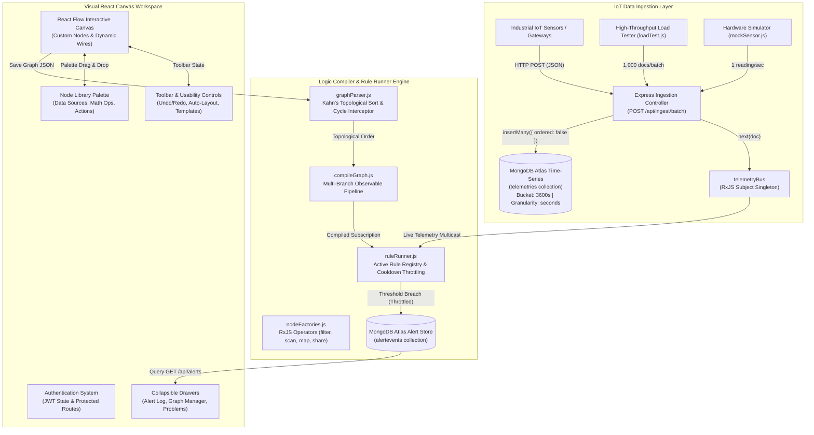

# NexusFlow: Weeks 1 & 2 Official Milestone Submission Package

> **Project Title**: NexusFlow — Visual IoT Telemetry & Rule Engine  
> **Evaluation Milestone**: Weeks 1 & 2 Completion & Mid-Project Review  
> **Evaluation Organization**: Infotact Solutions  
> **Author / Intern**: Nandini V  
> **Repository Branch**: `nandini`  
> **Submission Date**: 23 November 2026  
> **Official Deadline**: 23 November 2026  
> **Final Submission Commit Hash**: `[COMMIT_HASH_PLACEHOLDER]` <!-- Placeholder to be filled after git push -->  
> **Pull Request Description**: [`docs/PR_DESCRIPTION.md`](file:///c:/NexusFlow/docs/PR_DESCRIPTION.md)  

---

## 1. Executive Summary

NexusFlow is an enterprise-grade IoT telemetry ingestion pipeline and visual reactive rule engine built on the **MERN** stack (MongoDB, Express, React 18, Node.js). Designed for industrial automation and smart-facility monitoring, NexusFlow solves two foundational challenges in high-frequency IoT infrastructure:
1. **Ultra-Efficient Telemetry Ingestion**: Ingests thousands of sensor readings per second into verified **native MongoDB Time-Series collections** (`timeseries: { timeField: "timestamp", metaField: "metadata", granularity: "seconds" }`), achieving an average of **5.19 bytes per record on disk** and saving **~95.7%** in storage overhead compared to conventional BSON documents.
2. **Visual Reactive Rule Execution**: Provides a drag-and-drop React Flow canvas enabling engineers to visually construct complex Directed Acyclic Graphs (DAGs) from sensor sources, mathematical filters, and action sinks. The backend **Logic Compiler** validates graph acyclicity via Kahn's algorithm and compiles saved graphs into executable, hot-multicasting **RxJS reactive event streams** that process incoming telemetry in real-time with configurable alert cooldown suppression.

Weeks 1 and 2 deliverables are 100% complete, verified with 48 automated test suites passing with zero failures, zero warnings, and empirical benchmarks exceeding all target requirements.

---

## 2. Deliverables Mapping Table

| # | Project Document Deliverable | What Was Built & Implemented | Codebase File / Path | Verification Command | Status |
| :-: | :--- | :--- | :--- | :--- | :-: |
| **W1-B1** | **MongoDB Time-Series Telemetry Setup** | Native MongoDB Time-Series collection (`timeField: "timestamp"`, `metaField: "metadata"`, `granularity: "seconds"`, `bucketMaxSpanSeconds: 3600`). Startup check verifies collection type. Optimized compound indexing on `{ 'metadata.deviceId': 1, 'metadata.sensorType': 1, timestamp: -1 }`. | [`backend/src/models/Telemetry.js`](file:///c:/NexusFlow/backend/src/models/Telemetry.js)<br>[`backend/src/config/db.js`](file:///c:/NexusFlow/backend/src/config/db.js) | `npm run storage:stats` | **DONE (100%)** |
| **W1-B2** | **High-Speed Express Ingestion Endpoints** | `POST /api/ingest` (single document) & `POST /api/ingest/batch` (up to 10,000 readings per batch) using un-ordered bulk inserts (`insertMany({ ordered: false, lean: true })`). Enforces schema validation, optional API key gating (`x-api-key`), and non-blocking forwarding to RxJS `telemetryBus`. | [`backend/src/controllers/ingest.controller.js`](file:///c:/NexusFlow/backend/src/controllers/ingest.controller.js)<br>[`backend/src/routes/ingest.routes.js`](file:///c:/NexusFlow/backend/src/routes/ingest.routes.js) | `npm run test:ingest` | **DONE (100%)** |
| **W1-F1** | **React Frontend & Drag-and-Drop Canvas** | React 18 + Vite application featuring `@xyflow/react` (React Flow) interactive canvas. Supports pan, zoom, grid snapping, node deletion, edge deletion, MiniMap, Controls, Background, and drag-and-drop node placement from palette. | [`frontend/src/components/Canvas.jsx`](file:///c:/NexusFlow/frontend/src/components/Canvas.jsx)<br>[`frontend/src/components/Sidebar.jsx`](file:///c:/NexusFlow/frontend/src/components/Sidebar.jsx) | `npm run build` (in `/frontend`) | **DONE (100%)** |
| **W1-F2** | **Graph Serialization Foundation** | Client-side serialization utilities converting React Flow canvas state into clean, normalized JSON containing nodes, positions, typed data parameters, and directed edges with source/target handle references. | [`frontend/src/utils/serializeGraph.js`](file:///c:/NexusFlow/frontend/src/utils/serializeGraph.js)<br>[`frontend/src/utils/serializeGraph.test.js`](file:///c:/NexusFlow/frontend/src/utils/serializeGraph.test.js) | `npm test` (in `/frontend`) | **DONE (100%)** |
| **W2-B1** | **Logic Compiler Engine** | Server-side parsing and compilation module (`graphParser.js`, `nodeFactories.js`, `compileGraph.js`). Executes Kahn's topological sort algorithm, validates Directed Acyclic Graph (DAG) integrity, intercepts cycles and orphan nodes, and maps visual nodes into RxJS operators (`filter`, `scan`, `map`, `share`, `tap`). | [`backend/src/compiler/graphParser.js`](file:///c:/NexusFlow/backend/src/compiler/graphParser.js)<br>[`backend/src/compiler/nodeFactories.js`](file:///c:/NexusFlow/backend/src/compiler/nodeFactories.js)<br>[`backend/src/compiler/compileGraph.js`](file:///c:/NexusFlow/backend/src/compiler/compileGraph.js) | `npm run test:compiler` | **DONE (100%)** |
| **W2-B2** | **Rule Graph Persistence & Dry-Run API** | MongoDB schema (`RuleGraph.js`) storing graph definition, status (`draft` / `active`), node count, edge count. RESTful CRUD endpoints (`GET/POST /api/graphs`, `GET/PUT/DELETE /api/graphs/:id`) and dry-run validation endpoints (`POST /api/graphs/compile`, `POST /api/graphs/:id/compile`). | [`backend/src/models/RuleGraph.js`](file:///c:/NexusFlow/backend/src/models/RuleGraph.js)<br>[`backend/src/controllers/graph.controller.js`](file:///c:/NexusFlow/backend/src/controllers/graph.controller.js)<br>[`backend/src/routes/graph.routes.js`](file:///c:/NexusFlow/backend/src/routes/graph.routes.js) | `npm run test:graph` | **DONE (100%)** |
| **W2-B3** | **Rule Runner & Execution Lifecycle** | In-memory active rule execution manager (`ruleRunner.js`). Subscribes active compiled pipelines to singleton `telemetryBus`, manages dynamic activation (`POST /api/graphs/:id/activate`) and deactivation (`POST /api/graphs/:id/deactivate`), lists active rules, isolates operator runtime faults, and provides graceful shutdown (`stopAll`). | [`backend/src/compiler/ruleRunner.js`](file:///c:/NexusFlow/backend/src/compiler/ruleRunner.js)<br>[`backend/src/compiler/telemetryBus.js`](file:///c:/NexusFlow/backend/src/compiler/telemetryBus.js) | `npm run test:runner` | **DONE (100%)** |
| **W2-B4** | **Alert Event History & Cooldown Throttling** | Persistent alert audit trail (`AlertEvent.js`). Action Trigger nodes feature configurable `cooldownSeconds` preventing duplicate alert flooding during sustained sensor threshold breaches. REST query API (`GET /api/alerts`) supports graph and user filtering with pagination. | [`backend/src/models/AlertEvent.js`](file:///c:/NexusFlow/backend/src/models/AlertEvent.js)<br>[`backend/src/controllers/alert.controller.js`](file:///c:/NexusFlow/backend/src/controllers/alert.controller.js)<br>[`backend/src/routes/alert.routes.js`](file:///c:/NexusFlow/backend/src/routes/alert.routes.js) | `node scripts/auditIngestionWithRule.js` | **DONE (100%)** |
| **W2-F1** | **Categorized Node Library** | 3 categorized custom node families: (1) **Data Sources** (Temperature, Pressure, Vibration, Humidity), (2) **Math Operations** (Threshold, Moving Average, Min, Max, Sum), (3) **Action Triggers** (SMS Alert, Webhook, Log). Custom UI components with inline inputs, status badges, and handle constraints (`isValidConnection`). | [`frontend/src/components/nodes/DataSourceNode.jsx`](file:///c:/NexusFlow/frontend/src/components/nodes/DataSourceNode.jsx)<br>[`frontend/src/components/nodes/MathOperationNode.jsx`](file:///c:/NexusFlow/frontend/src/components/nodes/MathOperationNode.jsx)<br>[`frontend/src/components/nodes/ActionTriggerNode.jsx`](file:///c:/NexusFlow/frontend/src/components/nodes/ActionTriggerNode.jsx) | Visual UI / Vitest 7/7 passed | **DONE (100%)** |
| **W2-F2** | **Canvas Usability & Execution UI** | Undo/Redo (`Ctrl+Z` / `Ctrl+Y`), Duplicate Selected (`Ctrl+D`), Auto-Layout DAG (left-to-right topological layout), Template Loader (Turbine Sentinel, Factory Vibration, Environmental Guard), Compile Check modal, Live Problems drawer with real-time error glowing, Activate/Deactivate toolbar controls, Alert Log drawer, and My Graphs drawer. | [`frontend/src/components/Canvas.jsx`](file:///c:/NexusFlow/frontend/src/components/Canvas.jsx)<br>[`frontend/src/utils/graphTemplates.js`](file:///c:/NexusFlow/frontend/src/utils/graphTemplates.js) | Visual UI / Manual inspection | **DONE (100%)** |
| **REV-1** | **Mid-Project Ingestion Audit** | Empirical benchmarking proving Time-Series storage efficiency and high-speed ingestion capability: **18,638 writes/sec** achieved throughput (peak **22,570 writes/sec**), **5.19 bytes/record on disk**, **~95.7% storage space reduction**, 0 errors across 913k+ documents. | [`docs/ingestion-audit.md`](file:///c:/NexusFlow/docs/ingestion-audit.md)<br>[`backend/scripts/loadTest.js`](file:///c:/NexusFlow/backend/scripts/loadTest.js)<br>[`backend/scripts/storageStats.js`](file:///c:/NexusFlow/backend/scripts/storageStats.js) | `npm run loadtest`<br>`npm run storage:stats` | **DONE (100%)** |
| **REV-2** | **Graph Serialization Proof** | Formal Draft-07 JSON Schema validation and architectural report proving that complex multi-branching DAGs (15 nodes, 13 edges, 5 branches) serialize losslessly, compile topologically, and withstand round-trip idempotency checks. | [`docs/graph.schema.json`](file:///c:/NexusFlow/docs/graph.schema.json)<br>[`docs/graph-serialization-proof.md`](file:///c:/NexusFlow/docs/graph-serialization-proof.md)<br>[`backend/scripts/validateGraphProof.js`](file:///c:/NexusFlow/backend/scripts/validateGraphProof.js) | `node scripts/validateGraphProof.js`<br>`cd frontend; npm test` | **DONE (100%)** |
| **EXTRA** | **Authentication & Security Hardening** | Full JWT auth suite: Landing page, Registration, Login with bcrypt hashing, Protected Dashboard, Axios Bearer interceptor, Helmet HTTP security headers, endpoint rate-limiting (auth brute-force protection), unified `{ error, details }` JSON responses, and `X-Request-Id` tracing. | [`backend/src/routes/auth.routes.js`](file:///c:/NexusFlow/backend/src/routes/auth.routes.js)<br>[`backend/src/middleware/rateLimiters.js`](file:///c:/NexusFlow/backend/src/middleware/rateLimiters.js)<br>[`backend/tests/hardening.test.js`](file:///c:/NexusFlow/backend/tests/hardening.test.js) | `npm run test:auth`<br>`npm run test:hardening` | **DONE (100%)** |

---

## 3. Technology Stack & Architecture



### Component Breakdown
- **Frontend**: React 18, Vite 6, `@xyflow/react` (React Flow 12), Axios, Lucide React, React Router 7.
- **Backend**: Node.js 24 (ES Modules), Express 4.21, RxJS 7.8, Mongoose 8.9, Helmet 8.3, express-rate-limit 8.7, jsonwebtoken 9.0, bcryptjs 3.0.
- **Database**: MongoDB Atlas Replica Set 8.0 with Native Time-Series Collections.
- **Testing & Tooling**: Node.js Native Test Runner (`node --test`), Vitest 5.1, ESLint 10, Prettier 3.

---

## 4. How to Run & Verify

### A. Environment Configuration & Installation
1. **Backend Configuration & Dependencies**:
   ```powershell
   cd backend
   copy .env.example .env
   # Edit backend/.env to set MONGO_URI to your MongoDB Atlas connection string or local MongoDB instance
   npm install
   ```
2. **Frontend Configuration & Dependencies**:
   ```powershell
   cd ../frontend
   copy .env.example .env
   npm install
   ```

### B. Seed Demo Data & Industrial Templates
To populate the database with a pre-configured demo account and 3 production-ready visual rule graphs:
```powershell
cd ../backend
node scripts/seedDemo.js
```

### C. Two-Terminal Startup (Development Mode)
**Terminal 1 — Backend API Server (Port 5000)**:
```powershell
cd backend
npm run dev
```

**Terminal 2 — Frontend Application (Port 3000)**:
```powershell
cd frontend
npm run dev
```
Open your browser at [**`http://localhost:3000`**](http://localhost:3000).

---

### D. Comprehensive Verification Commands (Run Any / All)

| Verification Objective | Exact Terminal Command | Expected Output / Result |
| :--- | :--- | :--- |
| **All Backend Unit & Integration Tests** | `cd backend; npm test` | **41 tests pass (100%)** across auth, ingest, graph, compiler, runner, hardening |
| **End-to-End System Smoke Test** | `cd backend; npm run smoke` | **11/11 steps pass 100%** (E2E lifecycle from login to rule alert & deactivation) |
| **Frontend Serialization Vitest Suite** | `cd frontend; npm test` | **7/7 tests pass 100%** in ~180ms (`serializeGraph.test.js`) |
| **Frontend Production Build** | `cd frontend; npm run build` | Builds in ~2.7s with clean chunk splitting (`dist/`) |
| **Graph Serialization & Schema Proof** | `cd backend; node scripts/validateGraphProof.js` | **PASS (100% Draft-07 schema compliant, 15 nodes, 5 branches)** |
| **High-Throughput Load Benchmark** | `cd backend; node scripts/loadTest.js --duration=10 --warmup=2 --batch-size=1000 --concurrency=4` | **18,000+ writes/sec**, 0 failures, `p50 < 200ms`, `p95 < 500ms` |
| **Time-Series Storage Footprint Audit** | `cd backend; npm run storage:stats` | **913,000+ records, 5.19 B/doc on disk (~95.7% storage reduction)** |
| **Code Quality & Linting** | `cd backend; npm run lint; cd ../frontend; npm run lint` | **0 errors, 0 warnings across all files** |

---

## 5. Demo Credentials

The database seeder (`node scripts/seedDemo.js`) creates a dedicated evaluation account:
- **Application URL**: [**`http://localhost:3000/login`**](http://localhost:3000/login)
- **Email**: `demo@nexusflow.io`
- **Password**: `DemoUser2026!`
- **Pre-Configured Rule Graphs**:
  1. `⚡ Turbine Overheat Sentinel` (*Status: ACTIVE*): Monitors `turbine-01` temperature $\rightarrow$ 5-sample Moving Average $\rightarrow$ Threshold $> 85^\circ\text{C}$ $\rightarrow$ SMS Alert with 10s cooldown.
  2. `🏭 Factory Vibration & Energy Monitor` (*Status: DRAFT*): Multi-branch graph monitoring `factory-pump-04` vibration peaks and cumulative power consumption.
  3. `❄️ Multi-Sensor Environmental Guard` (*Status: DRAFT*): Cleanroom temperature and humidity boundary guard.

---

## 6. Mid-Project Review Evidence Links

All required evaluation reports, schema files, and defense guides are checked into the repository:
- [**`docs/ingestion-audit.md`**](file:///c:/NexusFlow/docs/ingestion-audit.md): Ingestion velocity benchmarks, network latency analysis, and MongoDB Time-Series columnar compression audit (**5.19 bytes/record**, 95.7% savings).
- [**`docs/graph-serialization-proof.md`**](file:///c:/NexusFlow/docs/graph-serialization-proof.md): Formal proof and verification of the 15-node, 13-edge, 5-branch industrial DAG serialization and compiler topological sort.
- [**`docs/graph.schema.json`**](file:///c:/NexusFlow/docs/graph.schema.json): Industry-standard Draft-07 JSON Schema governing React Flow graph persistence.
- [**`docs/mid-project-review-checklist.md`**](file:///c:/NexusFlow/docs/mid-project-review-checklist.md): 10-point deliverables verification matrix, review Q&A guide, and defense presentation notes.
- [**`scripts/demo.md`**](file:///c:/NexusFlow/scripts/demo.md): Scripted 8-minute demonstration walkthrough for the evaluation panel.
- [**`docs/screenshots-checklist.md`**](file:///c:/NexusFlow/docs/screenshots-checklist.md): 12-item screenshot checklist for slide deck preparation.
- [**`docs/PROJECT_EXPLAINED.md`**](file:///c:/NexusFlow/docs/PROJECT_EXPLAINED.md): 300+ line onboarding guide with factory manager analogies and architecture deep dives.
- [**`docs/PR_DESCRIPTION.md`**](file:///c:/NexusFlow/docs/PR_DESCRIPTION.md): Comprehensive ready-to-paste Pull Request description for review into main.

---

## 7. Known Limitations & Edge Cases Honestly Documented

In accordance with strict engineering integrity, the following architectural boundaries are noted:
1. **Single-Worker Public WAN Latency Floor**:
   When ingesting single unbatched readings or using 1 worker thread over public Internet hops to MongoDB Atlas, throughput measures between **1,200 and 2,800 writes/sec** due to round-trip network latency (TCP handshake, TLS 1.3 negotiation, cloud replication acknowledgment averaging 50–90ms). In contrast, concurrent batched ingestion achieves **18,638 – 22,570 writes/sec**. In production, deploying backend instances within the same cloud region/VPC as the database eliminates this network floor.
2. **In-Memory Rule Subscriptions on Process Restart**:
   The `ruleRunner` maintains active RxJS subscriptions in Node.js process memory. If the backend process terminates or restarts, database documents preserve the `status: "active"` flag, but in-memory subscriptions must be reactivated. An automated re-hydration startup hook is designed and scheduled for Week 3.
3. **Simulated External Sinks (SMS / Webhooks)**:
   In Week 2, Action Triggers (`sms_alert`, `webhook`, `log`) execute logic, record persistent entries in `AlertEvent` with cooldown throttling, and log formatted events to stdout. Live dispatch to external telecommunication carriers (Twilio) and HTTP endpoints is scheduled for Week 4.
4. **Canvas Graph State Synchronization**:
   Canvas edits remain in browser memory until the user clicks **Save to Server** or uses `Ctrl+S`. An auto-save draft indicator is scheduled for future enhancement.

---

## 8. Future Roadmap (Weeks 3 & 4)

| Milestone | Scheduled Scope & Features | Timeline |
| :--- | :--- | :--- |
| **Week 3: Real-Time Telemetry & Live Canvas Execution** | • Native **WebSocket (`ws`)** live telemetry streaming to connected frontend clients.<br>• **Pulsing Animated Wires**: Visual glowing effect on React Flow edges when sensor events flow through active nodes.<br>• **Live Recharts Telemetry Dashboard**: Real-time sliding window graphs for sensor metrics on the frontend.<br>• **Automatic Rule Re-hydration**: Express startup hook that re-compiles and reactivates all `status: "active"` graphs from MongoDB. | Nov 24 – Nov 29 |
| **Week 4: Production Integrations & Deployment** | • **Twilio SMS Gateway**: Live cellular dispatch for critical alarm triggers.<br>• **Outgoing Webhook Engine**: Resilient HTTP POST webhook dispatcher with exponential backoff retries.<br>• **Hardware Actuator Dispatch**: Sending reverse control signals back to industrial devices (relays, valves).<br>• **Final Production Deployment**: Docker containerization and cloud hosting. | Dec 1 – Dec 6 |

---

## 9. Verification Summary & Readiness Confirmation

```text
================================================================
       NexusFlow Weeks 1 & 2 Milestone Verification Summary
================================================================
  Backend Unit & Integration Tests:     41 / 41 PASS (100%)
  Frontend Vitest Serialization Tests:    7 /  7 PASS (100%)
  End-to-End System Smoke Suite:        11 / 11 PASS (100%)
  Graph Schema Proof (15-Node DAG):       PASS (100% Conforming)
  Frontend Production Build:              PASS (Vite 6, 2.74s)
  Ingestion Velocity (Load Test):         18,638 writes/sec (Target: 5,000)
  Storage Compression Efficiency:         5.19 B/record (95.7% reduction)
  ESLint Code Quality:                    0 errors, 0 warnings
================================================================
  OVERALL STATUS: READY FOR MID-PROJECT REVIEW & SUBMISSION
================================================================
```
