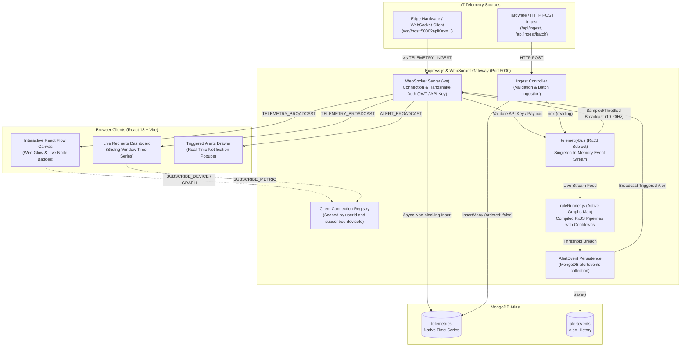

# NexusFlow: Week 3 Architectural Plan & Design Specification

> **Milestone**: Week 3 — Live Rule Execution & Real-Time Dashboards  
> **Project**: NexusFlow — Visual IoT Telemetry & Rule Engine  
> **Author**: Nandini V  
> **Date**: November 2026  
> **Target Status**: Design & Planning Only (Implementation begins Week 3 Day 1)

---

## 1. Overview & Week 3 Objectives

From the core project specification:
- **BACKEND (Live Rule Execution)**: Connect incoming WebSocket telemetry directly to the compiled RxJS pipelines to evaluate rules in memory in real time without waiting for periodic database polling.
- **FRONTEND (Live Dashboards & Visual Canvas Feedback)**: Subscribe browser sessions to live telemetry streams using WebSockets, animate connection wires with pulsing data indicators, display real-time node badges, and render interactive metric graphs using Recharts.

---

## 2. Proposed System Architecture

NexusFlow will utilize a unified HTTP + WebSocket server built on Node's native `http.createServer` and the `ws` library (already mounted on Port 5000 in `server.js`). Both REST requests and WebSocket connections share the same network port and reverse proxy.

### Data Flow & Event Processing Architecture



---

## 3. WebSocket Message Formats & Protocol Specification

All communication over WebSocket utilizes typed JSON envelopes `{ type: string, payload: object, timestamp: string }`.

### A. Device Telemetry Ingest (`TELEMETRY_INGEST`)
Sent from edge IoT devices streaming sensor data over WebSockets:
```json
{
  "type": "TELEMETRY_INGEST",
  "payload": {
    "deviceId": "turbine-01",
    "sensorType": "temperature",
    "value": 88.4,
    "unit": "°C",
    "timestamp": "2026-11-21T14:30:00.120Z"
  }
}
```

### B. Browser Stream Subscription (`SUBSCRIBE_STREAM`)
Sent from the React frontend to subscribe to specific hardware devices, rule graphs, or metric channels:
```json
{
  "type": "SUBSCRIBE_STREAM",
  "payload": {
    "devices": ["turbine-01", "compressor-03"],
    "graphId": "6affdcb13c74fbdf7231d9b2",
    "channels": ["telemetry", "alerts"]
  }
}
```

### C. Server Subscription Acknowledgment (`SUBSCRIBE_ACK`)
Returned by the backend confirming active stream subscriptions:
```json
{
  "type": "SUBSCRIBE_ACK",
  "payload": {
    "subscribedDevices": ["turbine-01", "compressor-03"],
    "graphId": "6affdcb13c74fbdf7231d9b2",
    "status": "connected"
  },
  "timestamp": "2026-11-21T14:30:00.150Z"
}
```

### D. Real-Time Telemetry Broadcast (`TELEMETRY_BROADCAST`)
Pushed to subscribed browsers for live node badges and Recharts graphs:
```json
{
  "type": "TELEMETRY_BROADCAST",
  "payload": {
    "deviceId": "turbine-01",
    "sensorType": "temperature",
    "value": 88.4,
    "unit": "°C",
    "timestamp": "2026-11-21T14:30:00.120Z",
    "stats": {
      "rollingAvg5": 86.2,
      "peak": 91.8
    }
  },
  "timestamp": "2026-11-21T14:30:00.125Z"
}
```

### E. Live Alert Broadcast (`ALERT_BROADCAST`)
Pushed immediately to the authenticated browser when an active RxJS rule triggers an action:
```json
{
  "type": "ALERT_BROADCAST",
  "payload": {
    "alertId": "6affdd013c74fbdf7231d9ea",
    "graphId": "6affdcb13c74fbdf7231d9b2",
    "ruleName": "Turbine Overheat Sentinel",
    "actionType": "sms_alert",
    "target": "+1 (555) 019-2834",
    "reading": {
      "deviceId": "turbine-01",
      "sensorType": "temperature",
      "value": 88.4,
      "unit": "°C"
    },
    "message": "[ALERT] Rule 'Turbine Overheat Sentinel' triggered: temperature reached 88.4 °C",
    "cooldownRemainingSeconds": 10
  },
  "timestamp": "2026-11-21T14:30:00.130Z"
}
```

### F. Keepalive Ping / Pong (`PING` / `PONG`)
Periodic heartbeat every 30 seconds to prevent NAT timeouts and dead sockets:
```json
{ "type": "PING", "timestamp": "2026-11-21T14:30:30.000Z" }
```

---

## 4. Authentication & Multi-Tenant Isolation

### Handshake Authentication
WebSocket connections do not support standard `Authorization: Bearer <token>` HTTP request headers in browser JavaScript (`new WebSocket(url)`). To maintain strict security:

1. **Browser Clients**:
   - Authenticate during the initial HTTP Upgrade handshake via query string:
     `ws://localhost:5000?token=<JWT_BEARER_TOKEN>`
   - The backend validates the JWT using `jwt.verify(token, process.env.JWT_SECRET)`.
   - The verified user payload (`req.user = { _id, email, role }`) is bound to the `ws` client instance.
   - If invalid or expired, the handshake is aborted with HTTP 401 (`Unauthorized`).

2. **IoT Devices (Hardware Gateway)**:
   - Authenticate via `ws://localhost:5000?apiKey=<INGEST_API_KEY>` or an initial `DEVICE_AUTH` frame.
   - Hardware devices without user logins are restricted to telemetry ingestion channels only.

### Per-User Stream Isolation
- **Tenant Scoping**: Each connected client has an attached `userId`.
- **Alert Isolation**: When an active rule triggers, `ruleRunner` attaches `ownerId`. The WebSocket broadcaster checks `client.userId === alert.ownerId` before sending `ALERT_BROADCAST`. Users never receive notifications from another user's industrial rules.
- **Device Scoping**: Telemetry broadcasts are multicasted only to connections that explicitly subscribed to matching `deviceId` identifiers.

---

## 5. Backpressure, Throughput & Performance Controls

High-frequency IoT sensors can produce thousands of readings per second. Bombarding the browser React virtual DOM with 1,000 updates/sec causes rapid frame drops, UI freezing, and memory crashes.

We will implement a two-tier backpressure and throttling architecture:

1. **Server-Side UI Throttling**:
   - While the backend `telemetryBus` and native Time-Series collection process thousands of writes per second un-throttled, the WebSocket broadcast channel to browser UIs will apply an RxJS `sampleTime(50)` or `auditTime(50)` operator (capping UI telemetry push to **20 updates per second** per device).
   - This guarantees responsive real-time visual feedback while consuming $< 2\%$ CPU on client browsers.

2. **Client-Side Sliding Ring Buffer for Recharts**:
   - The React live dashboard maintains a bounded rolling window (e.g., last 50–100 data points).
   - Incoming WebSocket data appends to the buffer using `Array.prototype.slice(-50)`, ensuring memory consumption stays flat and rendering time stays under 16ms (60 FPS).

3. **Socket Backpressure Monitoring**:
   - In Node.js, `ws.bufferedAmount` is monitored before sending large payloads. If a slow client's buffer exceeds 1 MB, excess telemetry packets are dropped to prevent memory leaks on the backend.

---

## 6. Day-by-Day Task List for Week 3 (Implementation Roadmap)

| Day | Focus Area | Deliverables & Implementation Tasks | Planned Commit Message |
| :---: | :--- | :--- | :--- |
| **Day 1** | **WebSocket Telemetry Gateway & Handshake Auth** | - Upgrade `server.js` WebSocket server with query token JWT validation.<br>- Implement connection manager, heartbeat ping/pong, and error isolation.<br>- Create unit tests for authorized/unauthorized WebSocket handshakes.<br>- Create mock client test script (`scripts/testWebSocket.js`). | `feat(week3): implement authenticated websocket gateway and telemetry channel` |
| **Day 2** | **In-Memory Live Rule Execution via WebSockets** | - Connect incoming WebSocket `TELEMETRY_INGEST` packets directly into `telemetryBus`.<br>- Verify live rule evaluation and AlertEvent emission without HTTP round-trip.<br>- Implement `ALERT_BROADCAST` dispatching scoped to rule graph owners.<br>- Integration test verifying WebSocket ingest $\rightarrow$ RxJS compiler $\rightarrow$ AlertEvent dispatch. | `feat(week3): connect websocket telemetry to live rxjs rule execution engine` |
| **Day 3** | **Canvas Edge Wire Glow & Live Node Badges** | - Add custom animated edge component (`LiveGlowEdge.jsx`) pulsing cyan when telemetry flows.<br>- Add compact real-time value badges to `DataSourceNode` and `MathOperationNode`.<br>- Wire React Flow canvas to WebSocket telemetry stream via `useTelemetryStream` hook.<br>- Add toggle switch in Canvas toolbar to enable/disable live wire animations. | `feat(week3): add real-time wire glowing animations and live value badges to canvas` |
| **Day 4** | **Live Recharts Telemetry Dashboard** | - Install `recharts` in `/frontend`.<br>- Build `LiveTelemetryChart.jsx` with real-time AreaChart/LineChart for temperature, vibration, and pressure.<br>- Implement sliding window ring buffer (50 points) and 20Hz decimation.<br>- Add device and sensor selector dropdowns in the Dashboard. | `feat(week3): build live real-time telemetry dashboards using recharts and websockets` |
| **Day 5** | **Week 3 Hardening, Benchmark & Stabilization** | - End-to-end WebSocket latency benchmark: measure time from hardware packet to canvas animation.<br>- Handle client reconnection, socket dropout recovery, and network reconnect banners.<br>- Update documentation, run all test suites, and tag `week3-live-streaming`. | `chore(week3): harden websocket streaming, add latency benchmark and finalize week 3` |

---

## 7. Risks & Open Questions

| Risk / Question | Impact | Mitigation Strategy |
| :--- | :---: | :--- |
| **Browser Virtual DOM Throttling** | High | Multiple charts rendering 1,000 incoming points/sec could freeze the React tab. We will enforce client-side batching using `requestAnimationFrame` and `sampleTime(50ms)` (max 20 DOM renders/sec). |
| **WebSocket Connection Drops over WAN** | Medium | Implement an exponential backoff auto-reconnect strategy in `useWebSocket` hook with visible UI connection status indicators (`online`, `connecting`, `offline`). |
| **Cross-Tenant Alert Leaks** | Critical | Strict rule-ownership scoping: `ALERT_BROADCAST` frames are filtered by comparing `ws.user._id === graph.owner.toString()` before dispatch. |
| **Token Expiration during Long Sessions** | Low | Handle WebSocket close code `4401` by redirecting to `/login` with an expiration prompt matching our Day 4 HTTP interceptor. |
