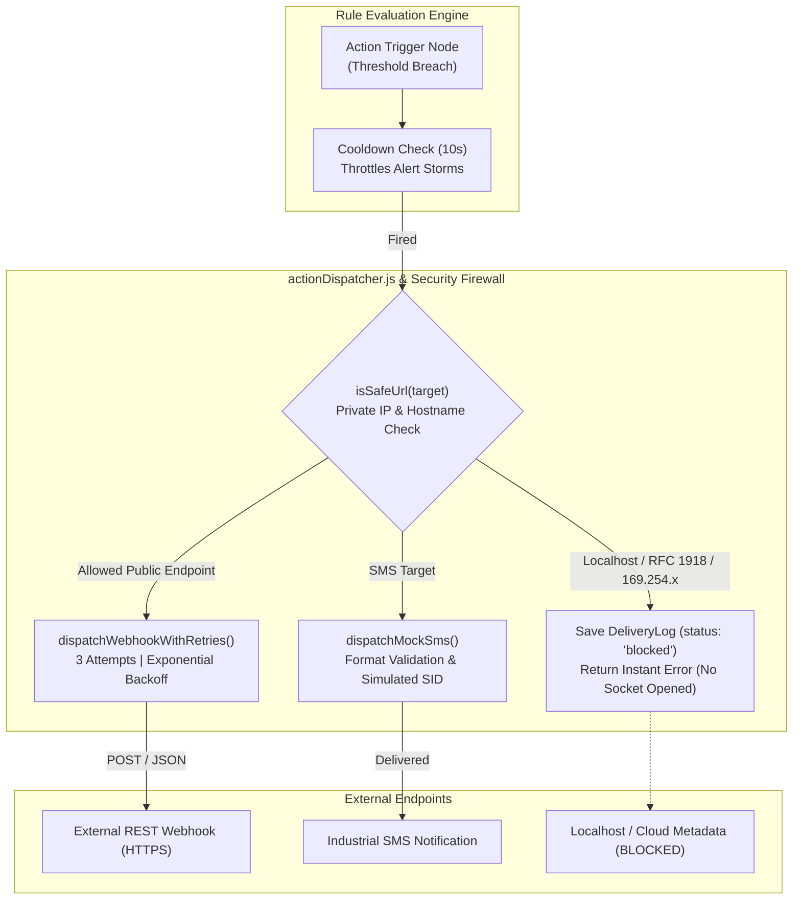

# NexusFlow: Week 4 Outbound Alerting, Wire Glow & Production Polish

> **Milestone**: Week 4 — Alert Dispatchers, Visual Canvas Glow & Production Polish  
> **Topic**: Outbound Webhooks, SSRF Protection, Retry Backoff, Delivery Logging & Wire Glow Animation  
> **Final Verification Date**: 27 November 2026  
> **Author**: Nandini V  
> **Repository Branch**: `nandini`  
> **Release Tag**: `week4-final`  

---

## 1. Executive Summary

Week 4 completed the final production deliverables of the NexusFlow platform. It delivered:
1. **Outbound Industrial Alert Dispatching**: Automated dispatching of alert payloads to external REST webhooks and mock SMS gateways when sensor thresholds are breached.
2. **Enterprise SSRF Protection**: A strict URL validator and IP firewall that blocks attempts to use webhooks to probe internal microservices or cloud metadata endpoints (`169.254.169.254`).
3. **Resilient Retry Queue**: Exponential backoff with up to 3 automatic attempts for transient 5xx / network failures.
4. **Delivery Audit Trail (`DeliveryLog`)**: A queryable MongoDB collection logging every dispatch attempt, duration, and response payload.
5. **Interactive Deliveries Drawer**: Built into the dashboard UI with live status filtering and a diagnostic SSRF test tool.
6. **Live Canvas Wire Glow**: High-performance custom `GlowEdge` components that visually pulse and flow when data passes through connections, paired with WCAG accessibility support (`prefers-reduced-motion`).

---

## 2. Outbound Action Dispatcher & SSRF Firewall

### SSRF Firewall Security Rules (`actionDispatcher.isSafeUrl`)

The firewall inspects all webhook URLs before initiating any network socket connection:
- **Protocol Enforcement**: Only `http:` and `https:` are permitted. Rejects `file:`, `ftp:`, `gopher:`, `data:`.
- **Hostname Restrictions**: Blocks `localhost`, `0.0.0.0`, `127.0.0.1`, `::1`, and domains ending in `.local`, `.localhost`, or `.internal`.
- **Private RFC 1918 IP Ranges**:
  - `10.0.0.0/8` (Class A private subnet)
  - `172.16.0.0/12` (Class B private subnet)
  - `192.168.0.0/16` (Class C private subnet)
- **Cloud Metadata Interception**: Blocks `169.254.0.0/16` (including `169.254.169.254` AWS / GCP instance metadata services).
- **Environment Flag**: Can be bypassed only in local sandbox environments by explicitly setting `ALLOW_PRIVATE_WEBHOOKS=true` (defaults strictly to `false`).

---

## 3. Webhook Retries & Delivery Audit Log

### A. Exponential Backoff Algorithm
Outbound webhooks execute inside `dispatchWebhookWithRetries()` with an `AbortController` timeout of 5,000 ms. If a transient error occurs, the dispatcher sleeps with exponential backoff before the next attempt:
$$\text{delay} = \min\left(1000, 100 \times 2^{\text{attempt}-1}\right)\text{ ms}$$

Client-side HTTP 4xx errors (e.g. 400 Bad Request, 404 Not Found) are not retried, preserving external server bandwidth.

### B. `DeliveryLog` Schema & APIs
Every outbound dispatch attempt is recorded in the `deliverylogs` MongoDB collection:
- `graphId`, `owner`: References to the rule graph and user account.
- `actionType`: `webhook` or `sms`.
- `target`: Clean destination URL or phone number.
- `status`: `success`, `failed`, `retrying`, or `blocked`.
- `attempts`: Number of HTTP requests executed (0 for blocked SSRF).
- `executionTimeMs`: Total elapsed duration in milliseconds.
- `responseStatus`, `responseBody`, `error`: Complete diagnostic payload.

**Endpoints**:
- `GET /api/deliveries`: Lists recent outbound deliveries with status filtering.
- `POST /api/actions/test`: Diagnostic tester allowing operators to test webhook or SMS dispatch with immediate SSRF rejection feedback.

---

## 4. Visual Canvas Wire Glow & Node Feedback

### A. Custom `GlowEdge` Component
Connections on the React Flow canvas utilize the custom `GlowEdge.jsx` component:
- **Idle State**: Subtle, dark slate stroke (`#334155`, 2px width).
- **Active Streaming State**: Glowing animated dash overlay (`#06b6d4` cyan or `#38bdf8` sky blue with drop-shadow filter).
- **High-Throughput Mode**: Stroke width expands to 3.5px with brighter glow when event counts exceed 5 events/second.
- **Rule Fired State**: Glowing rose stroke (`#f43f5e`, 3.5px width, 8px drop-shadow) when an action trigger is tripped.

### B. Performance Guarantee
To prevent canvas stuttering during high-frequency ingestion:
- Edges subscribe directly to `graphActivityStore.subscribeNode(sourceNodeId)`.
- Updates bypass React Flow's canvas-level state and re-render only the affected SVG path.
- State decays smoothly after 1,200 ms of inactivity.

### C. Accessibility Compliance (`prefers-reduced-motion`)
NexusFlow complies with WCAG 2.1 accessibility guidelines:
- `graphActivityStore.js` detects the user's OS-level motion preference via `window.matchMedia('(prefers-reduced-motion: reduce)')`.
- When reduced motion is preferred, all CSS keyframe animations (`@keyframes flowGlow`) and moving dash arrays are disabled, replaced with high-contrast static borders.

---

## 5. Verification Test Matrix

| Test Suite | File | Verified Capabilities | Status |
| :--- | :--- | :--- | :---: |
| **Action Dispatcher Suite** | `backend/tests/actionDispatcher.test.js` | SSRF blocking, private IP rejection, metadata defense, mock SMS validation, diagnostic API | **PASS (9/9)** |
| **Activity Tracker Suite** | `backend/tests/activityTracker.test.js` | 5Hz throttling, zero-cost skip without watchers, user/graph isolation, synchronous ruleFired | **PASS (7/7)** |
| **Client Activity Store** | `frontend/src/utils/graphActivityStore.test.js` | Subscription notification, graph isolation, decay timer, reduced motion support | **PASS (6/6)** |
| **End-to-End Smoke Test** | `backend/scripts/e2eSmoke.js` | Complete 11-step rule execution lifecycle against live server | **PASS (11/11)** |
